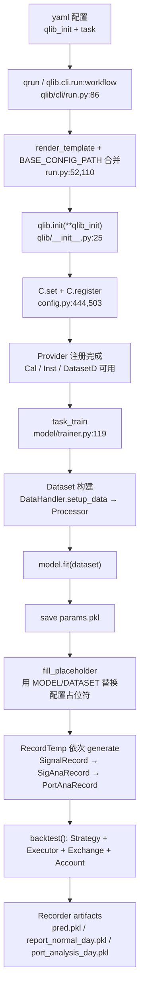

# 01 · 全景：Qlib 到底是个什么东西

> **一句话结论**：Qlib 不是"一个模型库"，而是一条把**历史行情**变成**可复现的策略评估**的流水线。它真正值钱的三样东西是：用表达式描述数据、把"决策"和"执行"彻底分开、把每次实验变成可追溯的对象。

**本章源码锚点**：`qlib/__init__.py:25`、`qlib/config.py:335`、`qlib/data/data.py:1142`、`qlib/data/dataset/handler.py:382`、`qlib/model/base.py:10`、`qlib/strategy/base.py:23`、`qlib/backtest/executor.py:22`、`qlib/workflow/__init__.py:27`。

---

## 1.1 它是框架，不是交易系统

| 它**是** | 它**不是** |
|---|---|
| 研究框架：数据 → 特征 → 标签 → 模型 → 信号 | 交易网关：仓库里没有任何券商/柜台 API |
| 回测引擎：bar 级的撮合、成本、约束近似 | 实时行情系统：有 client/server，但定位是离线/准实时推理 |
| 数据格式与访问层：二进制列存 + 表达式引擎 | 因子库：`Alpha158`/`Alpha360` 只是**示例基线**，不是产品 |
| 实验管理：基于 MLflow 的 recorder/artifact | 组合优化器：核心策略是 TopK 打分，优化器在 `contrib` 里且很薄 |

理解这个边界很重要：**你要搭的"自己的量化系统"，是把 Qlib 当作研究段的骨架，然后在两端各加一块**——前面加你自己的数据清洗/入库，后面加你自己的组合构建与（可选的）交易执行。

## 1.2 六层架构

```
L5 工作流      qlib/workflow      QlibRecorder(R) → Experiment → Recorder → RecordTemp
L4 策略与回测   qlib/strategy      BaseStrategy
               qlib/backtest      Decision → Executor → Exchange → Account/Position → Report
L3 模型        qlib/model         BaseModel / Model / Trainer
L2 数据集      qlib/data/dataset  DataLoader → DataHandler(LP) → Dataset(H) → TSDataSampler
L1 数据        qlib/data          Calendar / Instrument / Feature / PIT / Dataset Provider
                                  + 表达式引擎(ops, expression_parser) + 缓存(cache)
L0 基础设施    qlib/config.py     C 全局配置、qlib.init、init_instance_by_config、Serializable
               qlib/utils
```

| 层 | 关键对象 | 位置 | 你通常在这一层做什么 |
|---|---|---|---|
| L0 | `C`、`init_instance_by_config` | `qlib/config.py:335`、`qlib/utils/mod.py:176` | 配置数据路径、环境；把 yaml 变成对象 |
| L1 | 5 类 Provider、`Expression` | `qlib/data/data.py:64-448`、`qlib/data/base.py:13` | 接数据、写自定义算子 |
| L2 | `DataHandlerLP`、`DatasetH`、`Processor` | `qlib/data/dataset/handler.py:382`、`qlib/data/dataset/__init__.py:72` | 定义特征集、标签、训练/验证切分、标准化 |
| L3 | `Model.fit/predict` | `qlib/model/base.py:22` | 换模型（LightGBM/MLP/Transformer…） |
| L4 | `BaseStrategy`、`Executor`、`Exchange` | `qlib/strategy/base.py:23`、`qlib/backtest/*` | 改信号→订单的规则、改撮合假设 |
| L5 | `R`、`RecordTemp` | `qlib/workflow/__init__.py:27`、`qlib/workflow/record_temp.py:29` | 复现实验、批量扫参 |

## 1.3 核心抽象一页纸

| 名字 | 一句话职责 | 首次出现的位置 |
|---|---|---|
| `C` | 进程级全局配置单例（数据路径、频率、缓存、实验后端） | `qlib/config.py:335` |
| `Expression` | 数据的最小单位：一棵可求值的树（`$close`、`Mean($close,5)`） | `qlib/data/base.py:13` |
| `DataHandler` / `DataHandlerLP` | 把"日历×标的"的数据取成 DataFrame，并挂上加工流水线 | `qlib/data/dataset/handler.py:67,382` |
| `Dataset` / `DatasetH` | 在 handler 之上按时间段切片（train/valid/test） | `qlib/data/dataset/__init__.py:15,72` |
| `BaseModel` | 只有 `predict` 的窄契约；`Model` 加 `fit` | `qlib/model/base.py:10,22` |
| `Signal` | 把模型包装成"按时间取分数"的函数 | `qlib/backtest/signal.py:16` |
| `BaseStrategy` | 每个交易步产出 `TradeDecision`，**不碰订单细节** | `qlib/strategy/base.py:23` |
| `Order` / `TradeDecisionWO` | 订单（标的、数量、方向、时间窗）与"带订单的决策" | `qlib/backtest/decision.py:37,547` |
| `Exchange` | 撮合与约束：涨跌停、停牌、成交量、费用、成交价 | `qlib/backtest/exchange.py:28` |
| `Account` / `Position` | 现金、持仓、净值曲线、指标累计 | `qlib/backtest/account.py:71`、`position.py:231` |
| `Recorder` | 一次运行的所有产物（params/metrics/tags/artifacts） | `qlib/workflow/recorder.py:34` |
| `RecordTemp` | 把"一次实验"的若干步骤串起来的模板（信号、分析、回测） | `qlib/workflow/record_temp.py:29` |

## 1.4 设计哲学五条

### ① 表达式是一等公民，DataFrame 只是出口

Qlib 里数据不是"一张表"，而是**带时间窗口语义的表达式**：`$close`、`Ref($close,1)`、`Mean($close,5)/$close`。这带来三个直接好处：特征可序列化（yaml 里就能写）、可做窗口推导（自动多取 N 天历史）、可缓存（按表达式字符串做 key）。

**代价**：表达式引擎是自研的（`qlib/data/ops.py`），比 pandas 表达式啰嗦；复杂特征最终还是要落到自定义算子或 handler。

### ② 窄契约 + 配置装配

`BaseModel` 只有 `predict`，`Model` 只有 `fit(dataset)`；`BaseStrategy` 只有 `generate_trade_decision()`。窄接口让**任何实现都能被 yaml 装配**（`init_instance_by_config` 反射），也让单元测试极其容易。

**代价**：配置文件会变成"隐式接口"——你改了构造函数签名，yaml 静默失败，只在运行时炸。

### ③ 决策与执行分离

`Strategy` 说"我今天想买什么、买卖多少"，`Executor` 决定"这单拆成几步、按什么价成交"，`Exchange` 决定"这单到底能不能成交、成交多少"。三层各自可替换：日频组合策略 + 分钟级执行算法，是 Qlib 的招牌用法（`NestedExecutor`，`qlib/backtest/executor.py:310`）。

**代价**：概念多、对象多，第一次读会被 `level_infra`/`common_infra` 绕晕。

### ④ 实验即对象

每次运行都是 `Recorder`：参数、指标、标签、pickle 产物、依赖关系都挂在上面，`R.start(...)` 开、`R.get_recorder(...)` 取，可 `resume`。这让"这个夏普是哪份配置跑出来的"变成一次查询，而不是翻聊天记录。

**代价**：所有东西默认落到 `mlruns/` 目录（MLflow 文件后端），大 artifact 会迅速吃掉磁盘。

### ⑤ 可序列化 + 全局单例

`Serializable` 让 dataset/handler/processor/model 能整体 pickle；`C` 是进程级单例，`qlib.init()` 一次性把所有 Provider 注册好（`C.register()`，`qlib/__init__.py:78`）。

**代价**：**一个进程只能有一套数据配置**。想在同一进程里跑 A 股和美股两套数据，得靠 `C` 的 `provider_uri` 多频段设计或干脆分进程。

## 1.5 一次完整的旅程



## 1.6 它没有替你做的事

1. **数据口径**：复权方式、停牌填充、退市处理，都在 `dump_bin.py` 之前由你决定；Qlib 只保证"读到的东西和你写进去的一致"。
2. **标签定义**：`Ref($close,-2)/Ref($close,-1)-1` 是你写的，未来函数不会有人替你拦。
3. **组合优化**：核心只有 TopK，`EnhancedIndexingStrategy`（`qlib/contrib/strategy/signal_strategy.py:374`）是半成品参考。
4. **真实微观结构**：撮合是 bar 级近似，`impact_cost` 是线性冲击（`qlib/backtest/exchange.py:51`），不是订单簿模型。
5. **实盘**：`examples/online_srv/` 演示的是"滚动更新预测 + 管理在线模型"，不是下单。

## 1.7 自检

1. 为什么说 `BaseModel` 的窄契约是"设计优点"而不是"功能缺失"？
2. `Strategy` 与 `Executor` 分离后，各自能独立替换什么？
3. 同一进程里能否同时用两套 `provider_uri`？限制来自哪个对象？
4. Qlib 的"未来函数"防线在哪一层？它真的能防住吗？
5. 如果只让你保留三个模块来复刻 Qlib 的核心思想，你选哪三个？

> 参考答案要点：1) 可序列化、可装配、可测试；2) 策略换信号→目标仓位规则，执行换拆单/择时算法；3) 不能，`C` 是全局单例，`qlib.init` 只跑一次；4) 在 `PIT` 与 `Dataset` 切分，但标签是你自己写的，防不住"你自己把未来塞进特征"；5) 表达式引擎 + Dataset 切片 + Strategy/Executor 分离。
