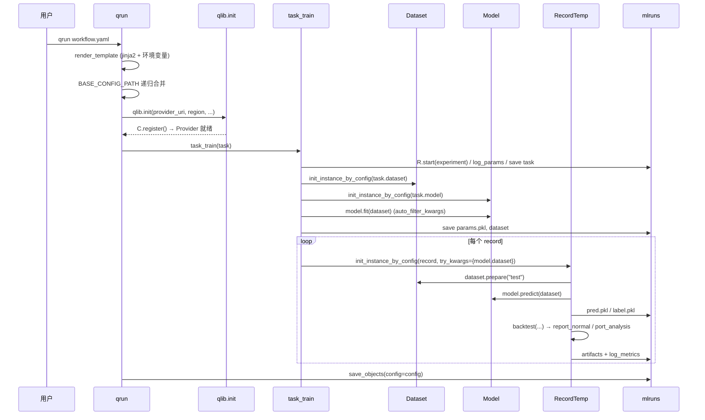

# 02 · 分层与调用链：一条 yaml 是怎么跑完的

> **一句话结论**：`qrun` 的全部工作就是 **读 yaml → 初始化全局配置 → 用反射把 yaml 变成对象 → 调 `fit` → 依次跑 `RecordTemp`**。看懂这 150 行，Qlib 就没有"魔法"了。

**本章源码锚点**：`qlib/cli/run.py`、`qlib/model/trainer.py:50-139`、`qlib/workflow/record_temp.py:29-260`、`qlib/utils/mod.py:176`、`qlib/utils/__init__.py:817`。

---

## 2.1 入口只有三行有效代码

```python
def workflow(config_path, experiment_name="workflow", uri_folder="mlruns"):
    ...
    recorder = task_train(config.get("task"), experiment_name=experiment_name)  # run.py:147
    recorder.save_objects(config=config)                                        # run.py:148

def run():
    fire.Fire(workflow)                                                         # run.py:152
```

`qrun xxx.yaml` 由 `pyproject.toml` 的 `[project.scripts]` 映射到 `qlib.cli.run:run`。

## 2.2 端到端时序



## 2.3 逐跳拆解

### Step 0 — 模板渲染（`run.py:52-82`）

yaml 先当 Jinja2 模板渲染，未声明变量从 `os.environ` 取。作用很实际：**同一份配置在 CI 与本机跑不同的数据路径/超参**。

```yaml
qlib_init:
    provider_uri: "{{ QLIB_DATA }}"
```

### Step 1 — 基线配置合并（`run.py:110-133`）

`BASE_CONFIG_PATH` 指向一份基线 yaml，当前文件只写差异字段，`update_config` 递归合并。这是 Qlib 官方 benchmark 的标准玩法：`workflow_config_lightgbm_Alpha158_csi500.yaml` 往往只有 5 行。

### Step 2 — 把 `sys.path` 加进去（`run.py:30-49`）

`sections.sys.path` / `sys.rel_path` 会被 append 到 `sys.path`。这是"yaml 里写 `module_path: my_pkg.model`"能工作的前提——**你的自定义模块不需要 pip install，只要路径对**。

### Step 3 — `qlib.init`（`qlib/__init__.py:25-84`）

```python
clear_mem_cache = kwargs.pop("clear_mem_cache", True)
if clear_mem_cache: H.clear()          # 清空内存缓存
C.set(default_conf, **kwargs)          # 写入全局配置，选择 client/server 模式
...
C.register()                           # 按配置注册 Provider 与缓存包装
```

关键点：
- `H.clear()`：**重初始化会清空所有表达式内存缓存**。这正是"同一进程里改数据后结果没变"的常见原因。
- `C.set`（`qlib/config.py:444`）：决定 `provider_uri` 怎么解析（本地目录 / NFS）、默认频率、`kernels`、实验后端。
- `C.register`（`qlib/config.py:503`）：把 `Cal`/`Inst`/`DatasetD` 这些**模块级单例**替换成带缓存的包装对象（`register_all_wrappers`，`qlib/data/data.py:1294`）。这是 Qlib 全局状态的来源。

### Step 4 — `task_train`（`qlib/model/trainer.py:119-139`）

```python
with R.start(experiment_name=experiment_name, recorder_name=recorder_name):
    _log_task_info(task_config)   # log_params + save task
    _exe_task(task_config)
    return R.get_recorder()
```

`R.start` 是上下文管理器：进入时创建/打开 experiment + recorder，退出时结束 run。**所有后续 `R.save_objects`/`log_metrics` 都写进这个 recorder。**

### Step 5 — `_exe_task`（`trainer.py:50-79`）核心 10 行

```python
model   = init_instance_by_config(task_config["model"],   accept_types=Model)
dataset = init_instance_by_config(task_config["dataset"], accept_types=Dataset)
auto_filter_kwargs(model.fit)(dataset, reweighter=reweighter)   # fit 可以只声明 dataset
R.save_objects(**{"params.pkl": model})
dataset.config(dump_all=False, recursive=True)                  # 在线推理用，别 dump 全量数据
R.save_objects(**{"dataset": dataset})
task_config = fill_placeholder(task_config, {"<MODEL>": model, "<DATASET>": dataset})
for record in records:
    r = init_instance_by_config(record, recorder=rec, default_module="qlib.workflow.record_temp",
                                try_kwargs={"model": model, "dataset": dataset})
    r.generate()
```

三个值得记住的细节：

1. **`auto_filter_kwargs(model.fit)`**：你的 `fit(self, dataset)` 不用写 `reweighter` 参数也能跑。便利，但也意味着签名写错不会报错。
2. **`dataset.config(dump_all=False)`**：dataset 里挂的 handler 可能持有几百 MB DataFrame，默认不落盘。
3. **`fill_placeholder`**（`qlib/utils/__init__.py:817`）：递归遍历配置字典，把 `"<MODEL>"` 这样的字符串替换成真实对象。`<PRED>` 是在 `PortAnaRecord._generate` 里替换的（`record_temp.py:476`）。

### Step 6 — `RecordTemp.generate()`

`SignalRecord.generate`（`record_temp.py:197`）只做两件事：`model.predict(dataset)` 存 `pred.pkl`，再把 test 段原始标签存 `label.pkl`。`PortAnaRecord._generate`（`record_temp.py:472`）才真正调用 `backtest()`，产出 `report_normal_*.pkl`、`positions_normal_*.pkl`、`port_analysis_*.pkl`。

这条链就是 Qlib 的"实验流水线"：**模型产出信号 → 信号喂给策略 → 策略在回测里变成订单 → 订单变成净值 → 净值变成指标**。

## 2.4 三个"魔法点"

| 魔法 | 实现 | 什么时候会让你踩坑 |
|---|---|---|
| yaml 里写 `<MODEL>` / `<PRED>` | `fill_placeholder` 递归替换 | 字符串恰好等于占位符时被误替换；嵌套 dict 里也能替换，注意别写进 `kwargs` 的普通字符串 |
| `class` + `module_path` | `init_instance_by_config`（`utils/mod.py:176`）反射 | 模块路径拼错时报 `ModuleNotFoundError`；构造函数签名改了不报错直到运行时 |
| `trusted: True` | 配置驱动的模块导入 / pickle 加载需要显式信任 | 这是安全边界，不是可选装饰：**不要把不可信的 yaml 直接跑 `qrun`**，它执行任意模块代码 |

顺便说清 `init_instance_by_config` 的三种输入（`utils/mod.py:143-170`）：

```python
# 1) dict + class/module_path + kwargs
{"class": "LGBModel", "module_path": "qlib.contrib.model.gbdt", "kwargs": {...}}
# 2) 完整路径字符串
"qlib.contrib.model.gbdt.LGBModel"
# 3) 直接传对象（accept_types 命中则原样返回）
model_instance
```

`accept_types` 让"yaml 或对象"两种写法共存，这是 Qlib 配置系统能同时服务 CLI 与 Notebook 的关键。

## 2.5 为什么这样分层

| 设计 | 收益 | 代价 |
|---|---|---|
| 配置驱动（yaml 即实验协议） | 实验可 diff、可复现、可批量生成 | 隐式接口、IDE 无补全、错误滞后 |
| 反射装配 | 插件式扩展，不改框架代码 | 安全面变大（因此有了 `trusted`） |
| `RecordTemp` 胶水 | 新增一种产物只需加一个子类 | 依赖关系靠 `depend_cls` 隐式约定 |
| 全局 `C` | 任意深度的代码都能取到配置 | 无法多数据集并行；测试要重置 |

当你的实验规模超过"几十次扫参"时，建议从 yaml 切到代码驱动：直接 `R.start(...)` + 显式构造 dataset/model，把 yaml 只留给基线复现。`examples/hyperparameter/` 展示的就是这条路。

## 2.6 用 25 行复刻一遍

```python
# 【示意代码】等价于 qrun 的最小骨架
import qlib
from qlib.workflow import R
from qlib.utils import init_instance_by_config

qlib.init(provider_uri="~/.qlib/qlib_data/cn_data", region="cn")

with R.start(experiment_name="my_exp"):
    dataset = init_instance_by_config(dataset_conf)   # DatasetH
    model   = init_instance_by_config(model_conf)     # Model
    model.fit(dataset)
    R.save_objects(params=model, dataset=dataset)

    from qlib.workflow.record_temp import SignalRecord, PortAnaRecord
    SignalRecord(model=model, dataset=dataset).generate()
    PortAnaRecord(recorder=R.get_recorder(), config=port_conf).generate()
```

## 2.7 自检

1. `qlib.init` 里 `H.clear()` 和 `C.register()` 分别解决什么问题？
2. 为什么 `dataset.config(dump_all=False)` 要在保存 dataset 之前调用？
3. `<PRED>` 是在哪一层被替换的？为什么不能在 `_exe_task` 里替换？
4. 你的自定义模块为什么不用安装就能被 yaml 引用？
5. 如果 `fit` 签名写成 `fit(self, dataset, **kwargs)`，`auto_filter_kwargs` 会有什么行为差异？

> 参考答案要点：1) 清缓存避免脏读、注册 Provider 并加缓存包装；2) 避免把大 DataFrame 序列化进 artifact；3) 在 `PortAnaRecord._generate`，因为 `pred` 要先由 `SignalRecord` 产出；4) `sys_config` 把配置里的路径塞进 `sys.path`；5) 不会过滤，`reweighter` 会一并传进去。
