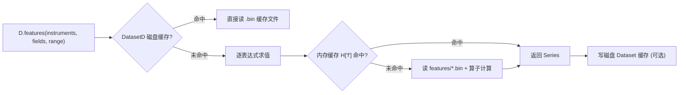

# 03 · 数据层：Provider、二进制列存与两层缓存

> **一句话结论**：Qlib 的数据层是一套"**目录约定 + 裸二进制列存 + 表达式索引**"的组合。它把"行情"变成"按交易日历对齐的 numpy 数组"，并用一层可插拔的 Provider + 缓存把 IO 藏起来。

**本章源码锚点**：`qlib/data/data.py:64-480`（五类 Provider 抽象）、`data.py:1290-1334`（注册）、`qlib/data/storage/file_storage.py:289`（文件布局）、`qlib/data/cache.py`（缓存）、`qlib/data/pit.py`。

---

## 3.1 磁盘上到底有什么

```
<provider_uri>/
├── calendars/
│   ├── day.txt            # 每个交易日一行，升序
│   └── 1min.txt           # 分钟频
├── instruments/
│   └── csi300.txt         # 每行: 标的代码 \t 上市日 \t 退市日
└── features/
    └── sh600000/
        └── close.day.bin  # 裸 float32 数组，无 header，按 calendar 索引
```

对应代码：`FileFeatureStorage` 的 `file_name = f"{instrument}/{field}.{freq}.bin"`（`qlib/data/storage/file_storage.py:289`），日历与标的池是 `.txt`（同文件 `:51`、`:201`）。

这套格式的三个设计意图：

| 设计 | 好处 | 代价 |
|---|---|---|
| 一条标的字段一个文件 | 顺序读极快，mmap 即可，无需解析 | 小文件极多（A 股 5000 标的 × 20 字段 = 10 万文件） |
| 裸 float32、无 header | 零解析开销，可直接 `np.fromfile` | 只能存单列；日期靠"行号=日历下标"隐式对齐 |
| 按日历对齐 | `Ref/Mean` 等窗口算子只需下标加减 | 停牌必须有占位（NaN），否则整体错位 |

**这条约定是 Qlib 性能的根**：任何窗口运算都退化成"数组切片 + 归约"，不需要 join、不需要重采样。

## 3.2 五类 Provider：按"数据形状"而非"业务"切分

| 抽象类 | 位置 | 回答什么问题 | 返回 |
|---|---|---|---|
| `CalendarProvider` | `data.py:64` | 交易日有哪些 | `list[Timestamp]` |
| `InstrumentProvider` | `data.py:198` | 某个股票池在某段时间有哪些标的 | `dict[str, (start, end)]` |
| `FeatureProvider` | `data.py:306` | 某标的某字段的原始序列 | `IndexData` / 单值 |
| `PITProvider` | `data.py:337` | 财务数据"在某个观察时点看到的值" | 按 period 索引 |
| `ExpressionProvider` | `data.py:382` | 表达式 → 计算 | `Expression` 计算结果 |
| `DatasetProvider` | `data.py:448` | 批量取"多标的 × 多字段 × 时间段" | `pd.DataFrame`（MultiIndex: instrument, datetime） |

注意这不是"一张表的四个切面"，而是**四种完全不同的访问模式**：日历是纯序列，标的是区间集合，特征是数组，PIT 是二维（观察时点 × 报告期）。硬塞进一个接口会互相拖累。

本地实现是 `LocalCalendarProvider`（`:639`）、`LocalInstrumentProvider`（`:680`）、`LocalFeatureProvider`（`:728`）、`LocalPITProvider`（`:746`）、`LocalExpressionProvider`（`:835`）、`LocalDatasetProvider`（`:884`）；对应的远程实现是 `Client*Provider`（`:963`、`:987`、`:1029`），走 socket 问服务端要"缓存文件在哪"。

## 3.3 门面：`D` 与 `Cal`/`Inst`/`DatasetD`

真正给用户用的是模块级单例：`D`（一个"全功能"门面，`BaseProvider`，`data.py:1142`）、`Cal`、`Inst`、`FeatureD`、`PITD`、`DatasetD`，都声明为 `Wrapper()` 占位（`data.py:1290-1291`）。

`qlib.init()` 触发的 `C.register()`（`qlib/config.py:503`）会调用 `register_all_wrappers`（`data.py:1294`）：

```python
_calendar_provider = init_instance_by_config(C.calendar_provider, module)
if C.calendar_cache is not None:
    _calendar_provider = init_instance_by_config(C.calendar_cache, module, provide=_calendar_provider)
register_wrapper(Cal, _calendar_provider, "qlib.data")     # data.py:1302
...
register_wrapper(D, C.provider, "qlib.data")               # data.py:1333
```

这是**装饰器模式的运行时装配**：Provider 是"被装饰者"，Cache 是"装饰者"，`Wrapper` 负责把属性访问转发过去（`qlib/utils/__init__.py:917`，`register_wrapper` 在 `:935`）。

于是日常代码可以这么写：

```python
from qlib.data import D

D.calendar(start_time="2020-01-01", end_time="2020-12-31", freq="day")
D.instruments(market="csi300")
D.features(["SH600000"], ["$close", "Mean($close,5)"], start_time="2020-01-01", end_time="2020-12-31")
```

**为什么用全局单例而不是依赖注入**：Qlib 的调用栈很深（Dataset → Handler → Loader → Provider → Expression），逐层传 provider 会污染所有签名。代价是**进程内只有一套配置**，且 `qlib.init` 是可观察的全局副作用。

## 3.4 两层缓存：内存按表达式，磁盘按数据集



| 缓存 | 类 | 位置 | key | 失效条件 |
|---|---|---|---|---|
| 内存（表达式级） | `H = MemCache()` | `cache.py:1198` | `(str(expr), instrument, start_idx, end_idx, *args)`（`base.py:187`） | `qlib.init(clear_mem_cache=True)`（默认） |
| 内存（LRU + 过期） | `MemCache` / `MemCacheExpire` | `cache.py:136,180` | 同上 | 容量/时间 |
| 磁盘（表达式级） | `DiskExpressionCache` | `cache.py:489` | 表达式字符串 + 范围哈希 | 手动删目录 |
| 磁盘（数据集级） | `DiskDatasetCache` / `SimpleDatasetCache` / `DatasetURICache` | `cache.py:646,1063,1117` | instruments + fields + 区间 + freq | `disk_cache=2` 覆盖 |

**踩坑清单**：

1. **改了 `features/*.bin` 但结果没变**——内存缓存还在。要么重启进程，要么 `qlib.init(clear_mem_cache=True)`。
2. **`disk_cache` 三态**：`0` 跳过、`1` 使用、`2` 覆盖（`data.py:1177`）。默认值来自 `C.default_disk_cache`。
3. **同一表达式不同 `args`**：PIT 的 `cur_pit`/`period` 也在 cache key 里（`base.py:187` 的 `*args`），否则会串数据。
4. **磁盘缓存跟数据版本无关**：换了复权因子但没删缓存目录，会读到旧结果。

## 3.5 PIT：为什么需要一个独立的小数据库

`PITProvider`（`data.py:337`）解决的是**财报的"当时看到的值"与"现在回看的值"不一致**：2020 年 Q3 的营收，在 2020-11 看到的是初值，在 2021-03 看到的是追溯调整后的值。

Qlib 的模型：**`(period, 观察时点) → 值`**。表达式里用 `$$` 前缀表示 PIT 字段（`PFeature`，`base.py:266`），求值时带上 `cur_pit`（当前观察时点）与 `period`，由 `LocalPITProvider`（`data.py:746`）取数。

磁盘上是独立的一份结构（**不在 `features/` 下**）：

```
financial/sh600000/roewa_q.index   # 观察日（int: yyyymmdd）
financial/sh600000/roewa_q.data    # 定长记录: (date, period, value, _next)
```

代码里体现得很直接（`data.py:784-795`）：用 `np.fromfile` 读定长记录，再 `np.searchsorted(data["date"], cur_time)` 找到"当前观察时点之前"的所有修订，取其中最大的 `period`。也就是说 PIT 不是"覆盖写"，而是**追加式的修订链**——每次财报修订追加一条记录，查询时回放。落盘脚本是 `scripts/dump_pit.py`。

这也是 Qlib 里**唯一真正内置的"防未来函数"机制**——它防的是"财报口径"这一类，不防"你自己用未来价格算特征"。

## 3.6 标的池与过滤器

两个容易混淆的机制：

| 机制 | 位置 | 作用时机 | 典型用途 |
|---|---|---|---|
| `inst_processors` | `qlib/data/inst_processor.py` | 取数后按标的做行级加工 | 剔除 ST、剔除上市不满 N 日、按行业中性化 |
| `filter_pipe` / `ExpressionDFilter` | `qlib/data/filter.py` | **选股之前**用表达式过滤标的池 | `$close > 5`、`Ref($volume,1) > 1e6` |

区别：`inst_processor` 是"对已选出的标的做加工/丢弃"，`filter` 是"决定哪些标的进入候选池"。后者更早、更便宜，能用它就别用前者。

## 3.7 迁移到自己系统

| 你的现状 | 建议 |
|---|---|
| 有 parquet/CSV 行情 | 写一个 `dump_bin` 脚本转成上面的目录结构（抄 `scripts/dump_bin.py`），不要急着实现自定义 Provider |
| 数据在数据库/行情 API | 实现 `FeatureProvider` 子类，`_load_internal` 返回按日历索引的 `pd.Series`，其余全部复用 |
| 需要跨市场（A 股+美股） | 分进程/分容器，各自 `qlib.init`；不要试图在一个进程里塞两套 `C` |
| 特征很复杂（图、文本） | 先落成 `features/*.bin` 的普通字段，再用表达式组合；表达式只做轻量运算 |

## 3.8 自检

1. 为什么 Qlib 选"一字段一文件"而不是一个大 parquet？瓶颈分别在哪？
2. `D` 是什么时候、由谁替换成真实 Provider 的？
3. 内存缓存 key 里为什么必须包含 `args`？
4. `inst_processors` 与 `filter_pipe` 的区别，什么时候必须用后者？
5. 换了复权口径后，需要清理哪些东西才能保证结果正确？

> 参考答案要点：1) 顺序读 + mmap，避免列裁剪与解压；代价是小文件多；2) `qlib.init → C.register → register_all_wrappers`；3) PIT 的 `cur_pit/period` 等参数会改变结果；4) 一个在取数后加工、一个在选股前过滤；5) 内存缓存 + 磁盘 `DiskExpressionCache`/`DiskDatasetCache` 目录。
