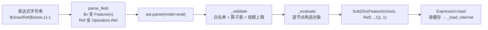

# 04 · 表达式引擎：`$close` 是怎么变成数组的

> **一句话结论**：Qlib 把字符串表达式编译成一棵 `Expression` 对象树，用**下标运算**在 numpy 数组上求值。解析走 Python `ast` + 白名单，求值走逐节点递归 + 内存缓存，整个过程不 `eval`、不生成代码。

**本章源码锚点**：`qlib/data/base.py:13-281`、`qlib/data/ops.py:1619-1686`、`qlib/data/expression_parser.py:307`、`qlib/utils/__init__.py:291`。

---

## 4.1 三层对象

```
Expression (abc)                       qlib/data/base.py:13
├── Feature            "$close"        :238   → 从 FeatureProvider 读原始列
├── PFeature           "$$revenue"     :266   → 从 PITProvider 读，带 cur_pit
└── ExpressionOps      算子树          :276
    ├── ElemOperator   单目：Abs/Log/Sign/Mask
    ├── PairOperator   双目：Add/Sub/Mul/Div/Gt/Lt
    └── Rolling*       窗口：Ref/Mean/Std/Corr/Rank...
```

`Expression` 只定义两件事：**怎么加载**（`load`，`base.py:142`）和**需要多少历史/未来数据**（`get_extended_window_size`，`:222`；`get_longest_back_rolling`，`:210`）。

## 4.2 从字符串到对象树

以 `$close/Ref($close, 1) - 1` 为例，解析分四步：



### ① 文本重写（`qlib/utils/__init__.py:291` `parse_field`）

```python
# $close          → Feature("close")
# $$revenue       → PFeature("revenue")     （$$ 必须在 $ 之前匹配）
# Mean(           → Operators.Mean(         （只重写标识符，不碰字符串字面量）
```

这一步用 `tokenize` 切 token，**只在非 STRING/COMMENT 片段上做替换**（`:324-332`），所以 `Feature("$close")` 里的 `$close` 不会被二次改写。

### ② 语法解析（`qlib/data/expression_parser.py:307`）

```python
tree = ast.parse(source, mode="eval")   # 得到 Python AST
_validate(tree)                          # 白名单校验（:97）
expression = _evaluate(tree.body)        # 逐节点构造 Expression 对象
```

`_validate`（`:97`）是这套引擎的安全边界，它做四件事：

1. **节点白名单**：只允许 `_SUPPORTED_NODES` 里的节点类型（字面量、名字、运算符、调用、容器、条件表达式等），其余一律 `_unsupported`（`:78`）；
2. **调用必须是已注册算子**：`_get_operator(node)`（`:103`）只认 `Operators` 表里的名字，`__import__`、`os.system` 之类进不来；
3. **字面量约束**：`BoolOp`、多比较、`IfExp` 的条件、以及部分容器，要求参数是纯字面量（`_require_literal`，`:133`）；
4. **规模上限**：容器与参数个数有上限（`_check_size`，`:127`），防止构造超大树。

所以 yaml 里写 `__import__('os').system(...)` 会在**解析阶段**被拒，而不是靠"相信配置文件"。

> 【设计评述】这是 Qlib 用"自研小语言"替代 `eval` 的直接后果：多花了 ~300 行解析器，换掉了整类 RCE。近期 commit `54355232`（*constrain config-driven code execution*）就是这条线的延续。

### ③ 归一化（`parse_expression` 的收尾）

```python
if not isinstance(expression, Expression):
    raise ExpressionSyntaxError(...)     # 表达式必须产出 Expression
```

### ④ 得到的树

```
Sub( Div( Feature(close), Ref(Feature(close), 1) ), 1 )
```

你可以直接验证：

```python
from qlib.data.ops import Operators
from qlib.utils import parse_field
parse_field("$close/Ref($close,1)-1")
# 'Feature("close")/Operators.Ref(Feature("close"),1)-1'
```

## 4.3 求值：`load` 与窗口推导

```python
def load(self, instrument, start_index, end_index, *args):        # base.py:142
    cache_key = str(self), instrument, start_index, end_index, *args
    if cache_key in H["f"]:                                       # 内存缓存
        return H["f"][cache_key]
    series = self._load_internal(instrument, start_index, end_index, *args)
    H["f"][cache_key] = series
    return series
```

`start_index`/`end_index` 不是日期，是**日历下标**。这就是"按日历对齐"的兑现方式：所有运算都是整型下标。

窗口算子的关键在 `get_extended_window_size()`：求 `[i, j]` 的 `Mean($close, 5)`，需要 `$close` 的 `[i-4, j]`。于是 `Rolling` 类算子会把自己的窗口"加"到底层节点的需求上，逐层累加，最终由 loader 一次性把数据取宽一点。`Ref($close, -1)`（未来值）在这里是**不支持的**（`base.py:219` 有明确 TODO），因为"向右扩展"会让"取数范围"失去上界。

## 4.4 算子注册：一张表 + 魔术属性

```python
class OpsWrapper:                                    # ops.py:1619
    def register(self, ops_list): ...                # :1628
    def get_operator(self, name): ...                # :1662
    def __getattr__(self, key):                      # :1668
        return self.get_operator(key)

Operators = OpsWrapper()                             # :1672

def register_all_ops(C):                             # :1675
    Operators.reset()
    Operators.register(OpsList + [P, PRef])          # 内置算子
    if getattr(C, "custom_ops", None): Operators.register(C.custom_ops)
```

于是 `Operators.Mean(...)` 等价于 `Operators.get_operator("Mean")(...)`。**自定义算子有两个入口**：

1. 继承 `ExpressionOps`/`ElemOperator`/`Rolling`，`Operators.register([MyOp])`（进程内）；
2. 放进 `C["custom_ops"]` 列表，`qlib.init` 时自动注册（配置级，推荐）。

算子必须实现三件事：`_load_internal(instrument, start, end, *args)`、`get_extended_window_size()`、`__str__()`（缓存 key 依赖它，写错会导致缓存串味）。

## 4.5 性能：Python 树 + Cython 叶子

两级实现：

| 层 | 位置 | 例子 |
|---|---|---|
| Python 对象树（每标的每算子一次） | `ops.py` | `Ref`、`Mean` 等包装类 |
| Cython 归约（窗口内的纯数值计算） | `qlib/data/_libs/rolling.pyx`、`expanding.pyx` | 滚动均值/标准差/相关性 |

所以"表达式慢"通常不是算子慢，而是**表达式树太深 + 标的分组太碎**：每个标的每次都要重新走一遍 Python 递归。真实场景里建议把复杂特征在 `dump_bin` 阶段固化成字段，表达式只做轻量组合。

## 4.6 常见写法与等价物

| 表达式 | 含义 | 等价 pandas |
|---|---|---|
| `$close` | 收盘价 | `df["close"]` |
| `Ref($close, 1)` | 前一日收盘 | `close.shift(1)` |
| `$close/Ref($close,1)-1` | 日收益率 | `close.pct_change()` |
| `Mean($close, 5)` | 5 日均价 | `close.rolling(5).mean()` |
| `Std($close, 20)/Mean($close,20)` | 20 日变异系数 | `rolling.std()/rolling.mean()` |
| `Rank($close, 20)` | 20 日时序排名 | `rolling.rank(pct=True)` |
| `Corr($close, Log($volume+1), 20)` | 量价相关性 | `rolling.corr()` |
| `$$revenue` | PIT 营收 | 无直接等价 |

注意 **`Mean` 的窗口是"含当日往前 N 个交易日"**，不是自然日；停牌日按 NaN 参与（`min_periods` 默认行为要看你用的算子实现）。

## 4.7 迁移到自己系统

1. **先别写算子**：80% 的特征都能用内置算子拼出来。先把 `Alpha158` 的 `qlib/contrib/data/loader.py` 读一遍，看官方怎么拼。
2. **要写算子时**，务必让 `__str__` 唯一且稳定，否则缓存 key 冲突（这是最隐蔽的 bug）。
3. **需要未来信息**（比如训练标签）时，不要在表达式里写负向 `Ref`，而是用 `Dataset.prepare` 拿原始标签再 `shift`。
4. **表达式不是 SQL**：它没有 join、没有 groupby。跨标的的横截面运算不在表达式层，而在 Processor 层——`CSRankNorm`（`qlib/data/dataset/processor.py:326`）、`CSZScoreNorm`（同文件 `:300`）、`CSZFillna`（`:362`）。这是重要的分层：表达式只管"单个标的时间序列"，横截面归 Processor。

## 4.8 自检

1. `parse_field` 为什么用 `tokenize` 而不是直接 `str.replace`？
2. `Expression` 树里谁负责"多取 5 天历史"？它怎么知道要 5 天？
3. 为什么 `Ref($close, -1)` 不被支持？
4. 自定义算子忘记重写 `__str__` 会发生什么？
5. 同一表达式在 `day` 和 `1min` 频率下，缓存会串吗？

> 参考答案要点：1) 避免改写字符串字面量里的 `$close`；2) `get_extended_window_size` 逐层累加；3) 未来数据没有上界，无法确定取数窗口；4) 默认 `str` 是类名，两个不同参数的同名算子会共用缓存 key；5) 不会，`args` 里带 `freq`。
