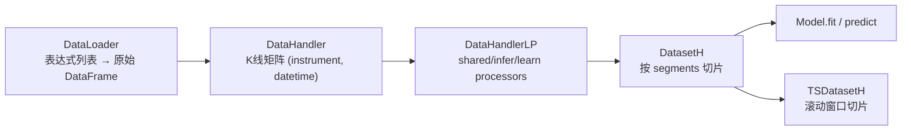

# 05 · 数据集层：Loader → Handler → Dataset 三段式

> **一句话结论**：Qlib 把"取数、加工、切片"拆成三个可独立替换的对象。`DataHandlerLP` 负责**语义加工**（归一化、去极值、丢样本），`DatasetH` 负责**时间切片**（train/valid/test），`TSDataSampler` 负责**滚动窗口视图**。搞混这三者的职责，是新手最常见的架构错误。

**本章源码锚点**：`qlib/data/dataset/loader.py:18,153,230`、`qlib/data/dataset/handler.py:67,382,633`、`qlib/data/dataset/processor.py:35`、`qlib/data/dataset/__init__.py:15,72,272,642`。

---

## 5.1 一条清晰的流水线



| 层 | 类 | 输入 | 输出 | 只做一件事 |
|---|---|---|---|---|
| 取数 | `DataLoader` | instruments + 时间 | 原始 DataFrame | 把表达式变成列 |
| 加工 | `DataHandler(LP)` | 原始 DataFrame | 三份加工后数据 | 特征工程、标签清洗 |
| 切片 | `Dataset(H)` | handler + segments | 指定时间段的 DataFrame | 训练/验证/测试隔离 |
| 窗口 | `TSDataSampler` | 切片后的 DataFrame | `(x, y)` 样本 | 时间序列样本化 |

## 5.2 DataLoader：表达式清单的执行者

`QlibDataLoader`（`loader.py:153`）继承 `DLWParser`（`:62`），配置长这样：

```yaml
handler:
  class: Alpha158
  module_path: qlib.contrib.data.handler
  kwargs:
    instruments: csi300
    start_time: 2008-01-01
    end_time: 2020-08-01
    fit_start_time: 2008-01-01
    fit_end_time: 2014-12-31
```

`Alpha158DL`（`qlib/contrib/data/loader.py:61`）返回的是 `{"feature": (表达式list, 列名list), "label": (...)}`，`DLWParser.load` 把两组表达式分别求值再 `concat`，得到一个 MultiIndex `(instrument, datetime)` 的宽表。

**另一个常被忽略的入口**：`StaticDataLoader`（`loader.py:230`）。你可以直接把一个 DataFrame 包成 loader：

```python
from qlib.data.dataset.loader import StaticDataLoader
loader = StaticDataLoader(df)          # df: index=(instrument, datetime)
```

这是"我有自己的特征表，不想走表达式"的最短路径。

## 5.3 DataHandlerLP：三种数据视图与两条加工流水线

`DataHandler`（`handler.py:67`）负责把 loader 的输出装进 `self._data`，并支持按时间/列取子集（`_fetch_data`，`:278`）。

`DataHandlerLP`（`:382`）在它之上加了三份数据：

| key | 属性 | 含义 | 典型消费者 |
|---|---|---|---|
| `DK_R` | `_data` | 原始数据（未加工） | 画图、算标签、调试 |
| `DK_I` | `_infer` | 推理用加工结果 | 线上预测 / test 段 |
| `DK_L` | `_learn` | 训练用加工结果 | `model.fit` |

为什么要分两份加工结果？类文档写得很清楚（`handler.py:396-402`）：

- 训练集和推理集的**标的池可能不同**；
- 某些加工**依赖标签**（比如"涨停样本要丢掉"），只能用于训练，不能用于推理。

两种组合方式（`process_type`）：

```
PTYPE_I = "independent":  _infer = shared + infer；  _learn = shared + learn
PTYPE_A = "append"     :  _infer = shared + infer；  _learn = shared + infer + learn   （默认）
```

`append` 的意义：推理侧也要做的加工（如行业中性化）只写一次，训练侧额外的（如按标签丢样本）再追加。

**执行顺序**（`setup_data`，`handler.py:633`）：

```python
if init_type == IT_FIT_IND:   self.fit(); self.process_data()
elif init_type == IT_LS:      self.process_data()
elif init_type == IT_FIT_SEQ: self.fit_process_data()    # 默认：先 fit 再 process
```

`fit` 只算统计量（均值/方差/分位数），`process` 才改数据。两者分开的原因是**训练集 fit、全量 apply**：

```yaml
infer_processors:
  - class: RobustZScoreNorm
    kwargs: {fields_group: feature, clip_outlier: true}
learn_processors:
  - class: DropnaLabel
  - class: CSRankNorm
    kwargs: {fields_group: label}
```

`fit_start_time`/`fit_end_time` 就是为了让 `RobustZScoreNorm` **只用训练期数据**算中位数/MAD——这两个参数写错（比如覆盖到 test），就是最典型的"温和的未来函数"。

## 5.4 Processor 契约：四个方法

```python
class Processor(Serializable):            # processor.py:35
    def fit(self, df=None): ...            # 只算统计量，不改数据
    def __call__(self, df): ...            # 真正加工
    def readonly(self): ...                # True = 不修改输入 df（可原地省内存）
    def is_for_infer(self): ...            # True = 推理阶段也要跑
```

`is_for_infer=False` 的处理器**只作用于训练数据**——`DropnaLabel`（`:105`）就是典型：推理时没有标签，不能因为它把数据丢空。

框架会检查 processor 链里是否混入 `readonly` 与 inplace 的组合（`_is_proc_readonly`，`handler.py:543`），避免"前一个处理器改了 df、后一个处理器以为拿到的是原数据"。

## 5.5 DatasetH：切片，而不是加工

```python
dataset = DatasetH(handler=handler, segments={
    "train": ("2008-01-01", "2014-12-31"),
    "valid": ("2015-01-01", "2016-12-31"),
    "test":  ("2017-01-01", "2020-08-01"),
})
df = dataset.prepare("test", col_set=["feature", "label"], data_key=DataHandlerLP.DK_L)
```

`prepare` 的四个参数（`dataset/__init__.py:185`）就是四个自由度：

| 参数 | 作用 | 常见错误 |
|---|---|---|
| `segments` | 时间切片（可传 list 一次取多段） | 段之间重叠 → 泄漏 |
| `col_set` | `feature` / `label` / `weight` / 全部 | 把 label 当 feature 喂进模型 |
| `data_key` | `DK_R/DK_I/DK_L` | 训练误用 `DK_I`（推理加工），统计口径不一致 |
| `data_granularity` | day/1min 等 | 与 handler 频率不一致 |

**关键区分**（handler.py:410-414 的注释专门强调过）：

- `DK_R/DK_I/DK_L` 是**加工口径**；
- `train/valid/test` 是**时间口径**。

两者正交。你可以用"推理口径的数据"去取"训练时间段"，这在做特征一致性检查时很有用。

## 5.6 TSDataSampler：为什么需要第四层

`TSDatasetH`（`:642`）在 `prepare` 时返回的不是 DataFrame，而是 `TSDataSampler`（`:272`）。原因：时间序列模型需要 `[t-step_len+1, t]` 的窗口，如果每个 batch 都在 DataFrame 上做 `iloc` 切片，开销会随 step 增长；`TSDataSampler` 预先构建"样本 → 行号"的映射（`build_index`，`:490`），取样本时直接按行号 gather。

```python
ds = TSDatasetH(handler=handler, segments=..., step_len=20)
x, y = ds.prepare("train", col_set=["feature", "label"])[0]   # x.shape: (20, n_feat)
```

代价：内存里要保留整块数据 + 索引；且 `step_len` 跨 segment 边界时会自动回退到更早的日期（`_extend_slice`，`:680`），所以 train 段的前 20 天实际上"借"了 valid 之前的数据——**这是设计允许的，但你要知道**。

## 5.7 三个高频坑

| 坑 | 现象 | 根因 | 处理 |
|---|---|---|---|
| 标签泄漏 | 回测 IC 高得离谱 | 标签用了未来价，或 processor 的 fit 区间覆盖 test | 检查 `fit_start/end_time`、检查 label 表达式是否含负向 `Ref` |
| `drop_raw=True` 后取不到原始数据 | `generate_label` 拿不到 label，`label.pkl` 为空 | handler 抛 `AttributeError`，`SignalRecord` 捕获后置 `None`（`record_temp.py:190-194`） | 需要原始标签就别开 `drop_raw`（`handler.py:666`） |
| 训练/推理列不一致 | 预测时 `KeyError` | learn 与 infer 的 processor 产出的列不同（如 `DropCol`） | 用 `get_cols(col_set, data_key)` 对齐检查 |

## 5.8 迁移到自己系统

| 需求 | 做法 |
|---|---|
| 已有特征宽表（parquet） | `StaticDataLoader(df)` → 自定义 handler 的 `data_loader` |
| 特征要用表达式但数据在别处 | 实现 `FeatureProvider`，其余复用 `QlibDataLoader` |
| 想做横截面标准化 | 用 `CSRankNorm`/`CSZScoreNorm`（`processor.py:326,300`），别在表达式里写 |
| 样本加权 | `Reweighter`（`qlib/data/dataset/weight.py`），`model.fit(dataset, reweighter)` |
| 时序模型 | `TSDatasetH(step_len=N)`，注意边界回退 |

## 5.9 自检

1. 为什么 `fit` 和 `process` 要分成两步？举一个不分开就会出错的例子。
2. `PTYPE_A` 与 `PTYPE_I` 的差别，各自适合什么场景？
3. `DK_L` 与 `test` 段是什么关系？能组合使用吗？
4. `TSDatasetH` 的 `step_len` 在 train 段开头会发生什么？
5. `readonly()` 返回 `True` 的处理器，为什么能省内存？

> 参考答案要点：1) 训练集统计量应用到全量，避免 test 泄漏；如 `RobustZScoreNorm`；2) A：infer 结果参与 learn 加工（省一次重复计算）；I：两条链完全独立；3) 正交，可组合（用训练口径的加工看测试段）；4) 向前借用更早的数据；5) 可以在原 df 上原地修改，不必 copy。
