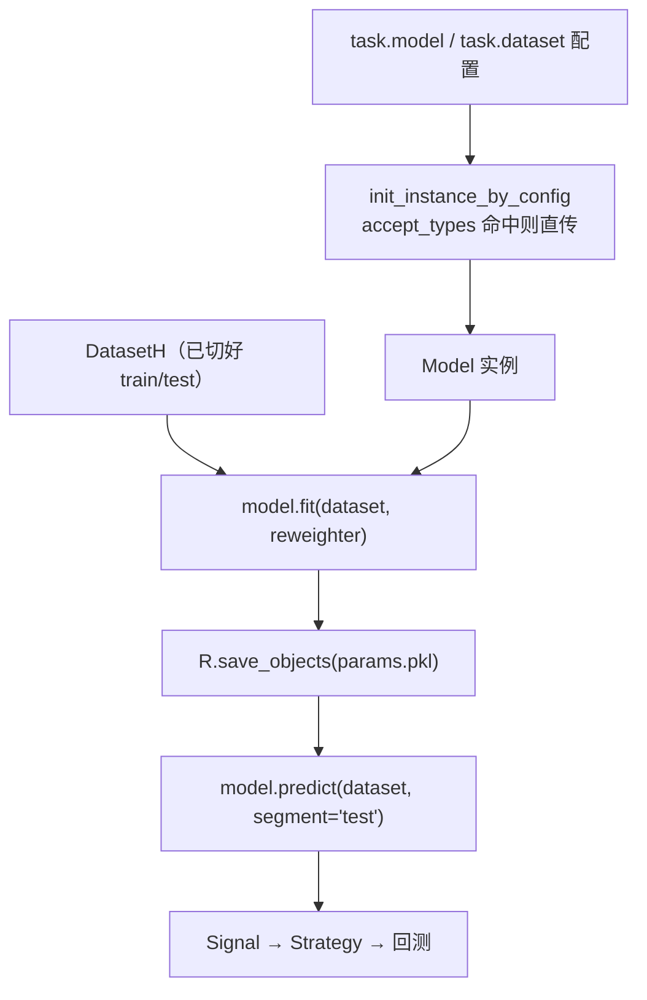

# 06 · 模型层：极窄契约与训练编排

> **一句话结论**：Qlib 的模型接口只有 `fit` 和 `predict` 两个方法，窄到"任何东西"都能塞进来——LightGBM、PyTorch、甚至一个查表函数。真正的复杂度不在模型，而在**谁负责切数据、谁负责存产物、谁负责并行**，这三件事被推到了 `Trainer` 和工作流层。

**本章源码锚点**：`qlib/model/base.py:10,22,81`、`qlib/model/trainer.py:50,119,142,220,304,364`、`qlib/utils/mod.py:176`。

---

## 6.1 契约

```python
class BaseModel(Serializable, metaclass=abc.ABCMeta):     # base.py:10
    def predict(self, *args, **kwargs) -> object: ...      # 唯一必须实现的方法
    def __call__(self, *args, **kwargs):                   # base.py:17，语法糖
        return self.predict(*args, **kwargs)

class Model(BaseModel):
    def fit(self, dataset: Dataset, reweighter: Reweighter): ...   # base.py:25

class ModelFT(Model):
    def finetune(self, dataset: Dataset): ...              # base.py:85
```



三个设计要点：

1. **`predict` 在基类，`fit` 在子类**。推理型模型（比如纯规则打分）不需要 `fit`，也能被 `Signal` 直接消费。
2. **`__call__` 转发到 `predict`**，所以 `model(dataset)` 与 `model.predict(dataset)` 等价，方便当函数传给别处。
3. **`Serializable`**：模型必须能 pickle（`R.save_objects(**{"params.pkl": model})`，`trainer.py:58`）。`Model.fit` 的文档特意提醒：`fit` 里赋的属性名**不要以下划线开头**，否则不会被序列化。

## 6.2 `predict` 的隐式契约：索引必须对得上

文档只写"返回 `pandas.Series`"，但回测层对它有硬要求：

```python
pred = model.predict(dataset, segment="test")
# 必须是 MultiIndex (datetime, instrument)，或能被 to_frame 的单列
# 顺序不重要（后面会 reindex），但 level 名字必须是 "datetime" / "instrument"
```

为什么重要：`SignalWCache.get_signal(start, end)`（`qlib/backtest/signal.py:60`）按时间切片，`TopkDropoutStrategy` 再按 `instrument` 对齐当前持仓（`contrib/strategy/signal_strategy.py:196`）。索引错了不会报错，只会**静默地选出错误的股票**。

## 6.3 最小实现

```python
# 【示意代码】写在你自己的包里，不是仓库文件
import pandas as pd
from qlib.model.base import Model
from qlib.data.dataset import DatasetH
from qlib.data.dataset.handler import DataHandlerLP

class MyModel(Model):
    def __init__(self, n_estimators=100, **kwargs):
        self.n_estimators = n_estimators       # 不能以下划线开头
        self.model = None

    def fit(self, dataset: DatasetH, reweighter=None):
        df_train = dataset.prepare("train", col_set=["feature", "label"], data_key=DataHandlerLP.DK_L)
        x, y = df_train["feature"], df_train["label"].iloc[:, 0]
        self.model = ...                        # 你的训练逻辑
        return self

    def predict(self, dataset: DatasetH, segment="test"):
        x = dataset.prepare(segment, col_set="feature", data_key=DataHandlerLP.DK_I)
        score = self.model.predict(x)
        return pd.Series(score, index=x.index, name="score")
```

注意两处 `data_key`：`fit` 用 `DK_L`，`predict` 用 `DK_I`。**这是 Qlib 里最容易写错、也最难发现的一行**——用错不会报错，只是线上线下特征口径不一致。

## 6.4 qrun 如何装配模型

```python
model = init_instance_by_config(task_config["model"], accept_types=Model)   # trainer.py:53
auto_filter_kwargs(model.fit)(dataset, reweighter=reweighter)               # trainer.py:57
```

`init_instance_by_config`（`utils/mod.py:176`）做了三件事：

1. `accept_types` 命中 → 原样返回（所以可以传对象）；
2. `str`/`Path` → 当模块路径导入；
3. `dict` → 取 `class`/`module_path`/`kwargs`，`get_module_by_module_path(...)` 后 `getattr` 再实例化。

`trusted` 参数（`mod.py:144`）控制是否允许从"配置指定的文件路径"导入模块。这是 0.9.8 的安全收紧点：**yaml 里能写 `module_path` 就意味着能执行任意代码**，所以现在需要显式信任。

## 6.5 `ModelFT`：为什么单独抽一个"微调"接口

`ModelFT`（`base.py:81`）只多一个 `finetune`。它的使用场景写在文档字符串里（`:88-102`）：

```python
with R.start(experiment_name="init models"):
    model.fit(dataset)
    R.save_objects(init_model=model)
    rid = R.get_recorder().id

with R.start(experiment_name="finetune model"):
    recorder = R.get_recorder(recorder_id=rid, experiment_name="init models")
    model = recorder.load_object("init_model", trusted=True)
    model.finetune(dataset, num_boost_round=10)
```

关键洞察：**"初始训练"与"增量微调"是两种不同语义的拟合**。前者要完整重训、可复现；后者要在已有权重上小步更新、通常按周/月滚动。分开接口，才能让滚动训练脚本不去碰 `fit` 的语义。

## 6.6 Trainer：训练编排的四个变体

`trainer.py` 解决的不是"怎么训"，而是"**批量任务怎么组织、失败了怎么续、怎么并行**"。

| 类 | 位置 | 并行方式 | 适用 |
|---|---|---|---|
| `task_train` | `:119` | 单进程、同步 | 默认，一次一任务 |
| `TrainerR` | `:220` | 线性循环 + 可选子进程（`call_in_subproc`） | 少量任务、内存吃紧（子进程强制释放） |
| `DelayTrainerR` | `:304` | 两阶段：`train` 只建 recorder，`end_train` 才真训 | 在线模拟中"先占位、后并发" |
| `TrainerRM` | `:364` | 基于 `TaskManager`（MongoDB）的任务池 | 多机、多卡、断点续训 |

`DelayTrainer` 的设计动机写在模块 docstring（`trainer.py:8-11`）：在线模拟里，"今天该训哪些模型"可以提前确定，但真正训练可以延后并发执行。于是 `train` 阶段只写 recorder 和 `train_status` tag，`end_train` 阶段再消费。

`TrainerRM` 的细节：任务写进 MongoDB（`TaskManager.create_task`），worker 用 `run_task` 拉取，状态从 `STATUS_WAITING` → `STATUS_PART_DONE` → `STATUS_DONE`；`TrainerRM.worker()` 可以跑在别的机器上（`trainer.py:489`）。**这是 Qlib 唯一需要外部依赖（MongoDB）的组件**，也是它"能上生产"的部分证据。

## 6.7 滚动训练：这套设计真正的用武之地

`examples/model_rolling/` 与 `examples/rolling_process_data/` 演示的是：给定一个"每月重训"的时间表，批量生成任务 → 每个任务训一个模型 → 每个模型产出一段预测 → 拼接成完整回测区间。

这正是 `Dataset` + `Recorder` + `Trainer` 三者配合的场景：

- `Dataset` 保证每个时间窗的 train/valid 不泄漏；
- `Recorder` 保证每个窗口的模型可追溯；
- `Trainer` 保证任务可批量、可并行、可续跑。

## 6.8 迁移到自己系统

1. **模型直接抄 `qlib/contrib/model/` 的写法**：`gbdt.py`（LightGBM）、`pytorch_*`（MLP/ALSTM/Transformer）。它们都只实现 `fit/predict` 两个方法，可直接作为骨架。
2. **不要在 `fit` 里做数据切片**：切片是 `Dataset` 的职责。`fit` 只接收"已经切好的 train 段"。
3. **不要在 `predict` 里做加工**：加工是 `DataHandlerLP` 的职责。`predict` 只接收 `DK_I`。
4. **模型要可 pickle**：不要持有打开的数据库连接、`lambda`、线程池。
5. **随机性要可控**：种子放在 `__init__` 参数里，不要读全局状态，否则无法复现。

## 6.9 自检

1. 为什么 `fit` 的参数是 `Dataset` 而不是 `DataFrame`？
2. `accept_types=Model` 的作用是什么？不传会怎样？
3. `ModelFT` 与 `Model` 的差异，只体现在接口上吗？
4. `TrainerRM` 为什么需要 MongoDB？不用它还能多机吗？
5. `predict` 返回的 Series 索引里，`instrument` 这个 level 名从哪来？

> 参考答案要点：1) 保留 segments/data_key 的语义，让模型不关心切分；2) 允许直接传模型对象，否则必须给配置 dict；3) 也体现在训练语义（全量重训 vs 增量）；4) 任务池与状态机需要持久化存储；可以用文件/Redis 自己实现；5) 来自 loader 产出的 MultiIndex，`DatasetH.prepare` 原样透传。
