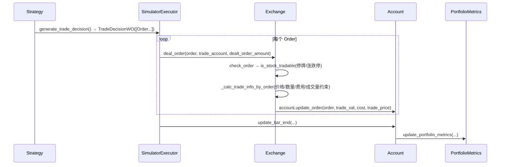

# 07 · 策略与回测：决策、执行、撮合、账户四层分离

> **一句话结论**：Qlib 的回测引擎把"**想做什么**（Strategy）"和"**能做成什么**（Executor + Exchange）"彻底切开，中间用 `TradeDecision` 传话。这个切法不是为了好看，而是为了让"日频选股 + 分钟级执行"这种真实需求变成**套娃**，而不是重写引擎。

**本章源码锚点**：`qlib/strategy/base.py:23`、`qlib/backtest/__init__.py:177,217`、`backtest.py:25,52`、`executor.py:22,310,513`、`exchange.py:28,417,421`、`decision.py:37,302,547`、`account.py:71`、`position.py:231`、`report.py:22,249`。

---

## 7.1 主循环：一个生成器撑起整个回测

```python
def collect_data_loop(start_time, end_time, trade_strategy, trade_executor, return_value=None):
    trade_executor.reset(start_time=start_time, end_time=end_time)     # backtest.py:82
    trade_strategy.reset(level_infra=trade_executor.get_level_infra()) # :83
    while not trade_executor.finished():                               # :87
        _trade_decision = trade_strategy.generate_trade_decision(_execute_result)  # :88
        _execute_result = yield from trade_executor.collect_data(_trade_decision, level=0)  # :89
        trade_strategy.post_exe_step(_execute_result)                  # :90
```

三个设计点：

1. **写成生成器**：`yield` 出每个决策，`backtest_loop`（`:25`）只是把它消费掉。这样 RL 训练可以 `for decision in collect_data_loop(...)` 逐步交互（`backtest/__init__.py:279` 的 `collect_data`），同一套代码同时服务回测与强化学习。
2. **`_execute_result` 回传**：策略能看到上一步"实际成交了什么"，这是实现"未成交则重试/改价"的基础。
3. **`finished()` 由 executor 的交易日历决定**：外层执行器走完自己的步数，回测结束。

## 7.2 装配：谁先创建谁

```python
def get_strategy_executor(...):                       # backtest/__init__.py:177
    trade_account  = create_account_instance(...)     # :193  先有账户
    trade_exchange = get_exchange(**exchange_kwargs)  # :206  再有交易所
    common_infra   = CommonInfrastructure(trade_account, trade_exchange)  # :208
    trade_strategy = init_instance_by_config(strategy, accept_types=BaseStrategy)  # :209
    trade_strategy.reset_common_infra(common_infra)   # :210
    trade_executor = init_instance_by_config(executor, accept_types=BaseExecutor)  # :211
    trade_executor.reset_common_infra(common_infra)   # :212
```

顺序不能乱：**账户和交易所是"共享基础设施"（`CommonInfrastructure`），策略和执行器都是它的消费者**。这也是 `BaseStrategy.trade_position` 能直接拿到 `common_infra["trade_account"].current_position` 的原因（`strategy/base.py:71`）。

`LevelInfrastructure` 则是"每层执行器自己的东西"：交易日历、步长、当前步索引。日频执行器与分钟执行器各有各的日历，所以是**层级**而不是共享。

## 7.3 四个对象与一次成交



### `Order`：一个"意图"，不是一个"结果"

`Order`（`decision.py:37`）的字段分三组，注释写得很明白：

| 组 | 字段 | 谁写 |
|---|---|---|
| 时间不变 | `stock_id`、`amount`、`direction` | 策略 |
| 时间相关 | `start_time`、`end_time` | 策略或 `TradeDecisionWO` 补默认值（`:561-567`） |
| 结果 | `deal_amount`、`factor` | 交易所回填 |

`amount` 是**非负的"调整后股数"**，方向靠 `direction`（`OrderDir.BUY/SELL`）表达；`sign` 属性把它变成 ±1（`:108`）。`factor` 是"实际成交比例"——成交量不足时小于 1，这时 `deal_amount = amount × factor`（近似）。

### `Exchange`：所有"真实世界约束"的收口

| 约束 | 方法/参数 | 说明 |
|---|---|---|
| 停牌 | `check_stock_suspended`（`exchange.py:378`） | `$close` 全为 NaN 或标的不在池内 → 视为停牌 |
| 涨跌停 | `check_stock_limit`（`:338`） | 依赖 `limit_buy`/`limit_sell` 字段；`limit_threshold=0.095` 时由 `_update_limit` 现算 |
| 可交易 | `is_stock_tradable`（`:404`） | 上面两者的或 |
| 成交价 | `deal_price`（构造参数，`:44`） | 支持 `close`/`open`/`vwap` 或 `(buy, sell)` 元组 |
| 成交量上限 | `volume_threshold`（`:47`） | 可设为"当日成交量的 x%"，由 `_clip_amount_by_volume`（`:786`）执行 |
| 整手 | `trade_unit`（默认 100，`:135`） | `round_amount_by_trade_unit`（`:761`） |
| 费用 | `open_cost=0.0015`、`close_cost=0.0025`、`min_cost=5`（`:48-50`） | 双边分别计，且有最低 5 元 |
| 冲击 | `impact_cost`（`:51`） | 线性滑点，默认 0（关闭） |

`deal_order`（`:421`）的返回是 `(trade_val, trade_cost, trade_price)`，并且**会原地改 `order.deal_amount`**。这一点在写自定义执行器时必须知道：`order` 不是不可变对象。

### `Account`/`Position`：钱和货

`Account`（`account.py:71`）持有 `cash` + `current_position` + 历史持仓 + `PortfolioMetrics` + `Indicator`。`Position`（`position.py:231`）是 `{stock_id: {amount, price, weight, count}}` + 现金，支持 T+N 结算（`settle_start`/`settle_commit`，`:201,218`）。

`InfPosition`（`:503`）是"无限资金"版本，用于测试信号本身、排除资金约束干扰——这是个很实用的调试工具：**先用 `InfPosition` 验证信号，再用真实 `Position` 验证可执行性**。

## 7.4 NestedExecutor：日频决策、分钟执行

`NestedExecutor`（`executor.py:310`）把"外层策略的一次决策"展开成"内层执行器的多个交易步"：

```python
def _init_sub_trading(self, trade_decision):        # :389
    # 用内层频率重建 trade calendar，范围为外层当前 step 的 [start, end]
```

机制是 `BaseTradeDecision.get_range_limit()`（`decision.py:391`）：外层决策携带一个"允许内层在哪个时间段内成交"的区间，内层策略（如 `TWAPStrategy`）在这个区间里拆单。

**为什么这样设计**：拆单是"执行算法"的事，不是"选股策略"的事。用嵌套而不是"让 Topk 策略自己拆单"，可以让 `TopkDropoutStrategy` 完全不知道分钟数据的存在。

代价：`level_infra` 的层级关系变复杂，调试时要打印 `get_all_executors()`（`executor.py:305`）才能看清结构。

## 7.5 一个必须讲清的细节：`shift=1`

`TopkDropoutStrategy.generate_trade_decision`（`contrib/strategy/signal_strategy.py:137`）：

```python
trade_step = self.trade_calendar.get_trade_step()
trade_start_time, trade_end_time = self.trade_calendar.get_step_time(trade_step)
pred_start_time, pred_end_time = self.trade_calendar.get_step_time(trade_step, shift=1)  # ← 注意
pred_score = self.signal.get_signal(start_time=pred_start_time, end_time=pred_end_time)
```

**用 `shift=1` 拿"上一期"的预测，是因为：**

- 今天开盘要下单，但今天的收盘价还没发生；
- 模型用的是 `T-1` 收盘后能拿到的特征，产出的预测对应"`T-1` 这天"；
- 所以 `T` 日交易要用 `T-1` 的预测。

如果这里写成 `shift=0`，你的回测会立刻"变好"，而且好得离谱——这是 Qlib 里最经典的一次性错误。**框架把 `shift` 暴露给你，而不是帮你做**，因为它也支持"盘中生成信号、盘中交易"的分钟级场景。

## 7.6 报表：两条线

| 产物 | 类 | 内容 |
|---|---|---|
| 组合净值 | `PortfolioMetrics`（`report.py:22`） | `return`、`bench`、`cost`、`turnover`，按日/分钟 |
| 交易指标 | `Indicator`（`report.py:249`） | 成交率 `ffr`、价格优势 `pa`、正收益比例 `pos`、成交额 |

`Indicator` 的 `pa`（price advantage）是 Qlib 比较独特的东西：它衡量"你的成交价比基准价（twap/vwap）好多少"，用来看**执行算法**的质量，而不只是策略收益。配置入口是 `indicator_config`（`executor.py:30`）。

## 7.7 回测检查清单（每条都对应一个真实 bug）

1. `shift` 用对了吗？（预测 vs 交易日期）
2. `deal_price` 是 `close` 还是 `open`？用 `close` 意味着"当日收盘价成交"，等价于**偷看**了收盘。
3. `limit_threshold` 设置了吗？不设等于允许涨停买入。
4. 成本是否双边都算了？`min_cost` 对小单影响巨大。
5. `volume_threshold` 设了吗？不设等于你的单子可以无限大。
6. `trade_unit=100` 生效了吗？不整手会得到"不可能成交"的结果。
7. 停牌日的持仓怎么估值？（`fill_stock_value`，`position.py:280`）
8. 基准对了吗？`benchmark=SH000300` 但股票池是 csi500，超额收益就没意义。

## 7.8 迁移到自己系统

| 需求 | 做法 |
|---|---|
| 换选股规则 | 继承 `BaseStrategy`，实现 `generate_trade_decision`，返回 `TradeDecisionWO` |
| 换执行算法（TWAP/VWAP/跟量） | 继承 `BaseStrategy`，放进 `NestedExecutor.inner_executor` |
| 换撮合模型（订单簿、冲击） | 继承 `Exchange`，重写 `_calc_trade_info_by_order` |
| 只验证信号 | 用 `InfPosition` + `TopkDropoutStrategy`，关掉成本 |
| 实盘对接 | 不要在 `Exchange` 里塞 HTTP；实现一个"实盘 Executor"，把 `TradeDecision` 转成券商指令，回填 `execute_result` |

最后一行的建议很重要：**Qlib 的 `Executor` 是"成交模拟器"，不是"下单客户端"**。想接实盘，正确姿势是实现一个新 Executor，而不是改 `Exchange`。

## 7.9 自检

1. 为什么 `Order.amount` 非负，方向单独存？
2. `NestedExecutor` 里，内层和外层的交易日历是什么关系？
3. `deal_order` 里为什么要传 `dealt_order_amount`？
4. `shift=1` 除了防未来函数，还有什么语义？
5. 想验证"信号本身好不好"，怎么排除资金和撮合的影响？

> 参考答案要点：1) 让 `sign`/`deal_amount` 的符号运算统一，避免负数量表达卖出；2) 内层日历由外层 step 的 `[start,end]` 重新生成，是子区间；3) 同一标的一天内多次下单要共享"已成交量"，才能正确施加 `volume_threshold`；4) 表达"决策发生在上一期"，支持 T+1 与 T+0 两种设定；5) `InfPosition` + 关闭成本 + 直接看 `Signal` 的 IC。
