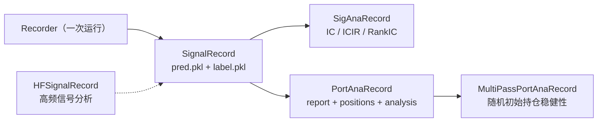

# 08 · 工作流：把"一次实验"变成一个对象

> **一句话结论**：`R`（`QlibRecorder`）是 Qlib 的实验门面，底下是 `ExpManager → Experiment → Recorder` 三层，再底下是 **MLflow 的实现**。`RecordTemp` 则是一组"模板方法"，把"预测 → 分析 → 回测"串成可跳过、可续跑的流水线。

**本章源码锚点**：`qlib/workflow/__init__.py:27,482,537`、`expm.py:22,317`、`exp.py:15,243`、`recorder.py:34,257`、`record_temp.py:29,168,219,302,365`。

---

## 8.1 四层对象

```
R (QlibRecorder)                 workflow/__init__.py:27     ← 你唯一需要 import 的东西
└── ExpManager                   expm.py:22                   ← 管理多个 experiment（MLflowExpManager:317）
    └── Experiment               exp.py:15                    ← 一次研究主题（MLflowExperiment:243）
        └── Recorder             recorder.py:34               ← 一次运行（MLflowRecorder:257）
```

`R` 的方法就是这三层的快捷方式：

| 方法 | 作用 | 行号 |
|---|---|---|
| `R.start(experiment_name=..., recorder_name=...)` | 开启/复用一次运行（上下文管理器） | `:39` |
| `R.get_recorder(recorder_id=..., experiment_name=...)` | 取回一次运行 | `:393` |
| `R.save_objects(**{"pred.pkl": df})` | 存 artifact（pickle） | `:482` |
| `R.load_object("pred.pkl", trusted=...)` | 取 artifact | `:537` |
| `R.log_params(**kwargs)` / `R.log_metrics(step=..., **kwargs)` | 记参数/指标 | `:550` / `:575` |
| `R.set_tags(**kwargs)` | 打标签（用于检索） | `:638` |
| `R.search_records(experiment_ids, filter_string=...)` | 按条件查 | `:166` |
| `R.get_uri()` / `R.set_uri(uri)` / `R.uri_context(uri)` | 切换后端地址 | `:346,362,374` |

## 8.2 落盘长什么样

`qrun` 默认把 `exp_manager.kwargs.uri` 设成 `file:<cwd>/mlruns`（`qlib/cli/run.py:142`）。MLflow 文件后端的目录约定是：

```
mlruns/
└── <experiment_id>/
    ├── meta.yaml
    └── <run_id>/
        ├── meta.yaml          # 状态、开始时间
        ├── params/            # 每个参数一个文件
        ├── metrics/           # 每个指标一个文件（按 step 追加）
        ├── tags/
        └── artifacts/         # ← 你的 pred.pkl / report_normal_day.pkl 都在这
```

一次 `qrun` 之后，`artifacts/` 里典型有：

| 文件 | 谁写的 | 用途 |
|---|---|---|
| `params.pkl` | `_exe_task`（`trainer.py:58`） | 训练好的模型 |
| `dataset` | `trainer.py:61` | dataset（`dump_all=False`，只存配置） |
| `pred.pkl`、`label.pkl` | `SignalRecord`（`record_temp.py:202,213`） | 预测与真值 |
| `report_normal_day.pkl` | `PortAnaRecord`（`:499`） | 净值曲线 |
| `positions_normal_day.pkl` | 同上（`:500`） | 每日持仓 |
| `port_analysis_day.pkl` | 同上（`:526`） | 风险指标 |
| `indicators_normal_day.pkl` | 同上（`:503`） | 执行指标 |

**这个目录就是你的"实验数据库"**。规模小的时候，用 `mlflow ui` 看足够；规模大了再换数据库后端（`R.set_uri("http://...")`）。

## 8.3 `RecordTemp`：模板方法 + 依赖图

`RecordTemp`（`record_temp.py:29`）定义了三件事：

```python
class RecordTemp:
    artifact_path = None      # 产物存到哪个子目录
    depend_cls = None         # 依赖哪个上游 RecordTemp

    def save(self, **kwargs): ...        # 调 recorder.save_objects
    def load(self, name, parents=True): ...   # 取产物，必要时先跑上游
    def check(self, include_self=False): ...  # 检查产物是否齐全
```

继承结构：

```
RecordTemp
├── SignalRecord                     :168   model.predict → pred.pkl / label.pkl
├── ACRecordTemp                     :219   "自动检查"中间层：先 check，再 _generate
│   ├── SigAnaRecord                 :302   IC / ICIR / Rank IC / 多空精度
│   ├── PortAnaRecord                :365   backtest → report / analysis
│   └── MultiPassPortAnaRecord       :582   多次随机初始持仓的稳健性检验
└── HFSignalRecord                   :255   高频版信号分析
```

`ACRecordTemp.generate`（`:226`）的流程值得抄：

```python
if self.skip_existing:
    try: self.check(include_self=True, parents=False)
    except FileNotFoundError: pass
    else: return                      # ← 已存在就跳过
try: self.check()                     # ← 上游不存在就跳过
except FileNotFoundError: return
artifact_dict = self._generate(**kwargs)
self.save(**artifact_dict)
```

`skip_existing=True` 是滚动训练的关键：同一个 recorder 续跑时，不重复算已经算过的部分。



**依赖关系是隐式的**：`SigAnaRecord.depend_cls = SignalRecord`，所以 `SigAnaRecord.generate()` 会先确认 `pred.pkl` 存在，不存在就跳过（而不是报错）。这带来一个好处：`record` 列表里少写一个，也不会崩；坏处是：**少写一个你不会立刻知道，只会得到一个空的分析结果**。

## 8.4 `task_train` 里 record 列表的执行

```yaml
task:
  record:
    - class: SignalRecord
      kwargs: {model: "<MODEL>", dataset: "<DATASET>"}
    - class: SigAnaRecord
      kwargs: {ana_long_short: False, ann_scaler: 252}
    - class: PortAnaRecord
      kwargs: {config: *port_analysis_config}
```

`_exe_task`（`trainer.py:66-79`）对每个 record：

```python
r = init_instance_by_config(record, recorder=rec,
                            default_module="qlib.workflow.record_temp",
                            try_kwargs={"model": model, "dataset": dataset})
r.generate()
```

两个细节：

1. `default_module` 让 yaml 只写 `class: SignalRecord`，不用写 `module_path`。
2. `try_kwargs` 会"尝试把 model/dataset 传进去，失败就退回不传"——因为 `SigAnaRecord` 的构造函数只要 `recorder`。

## 8.5 检索与复现

```python
from qlib.workflow import R

R.list_experiments()                                      # 所有实验
recs = R.list_recorders(experiment_name="workflow")       # 某实验下所有 run
recs = R.search_records([exp_id], filter_string="metrics.IC > 0.03")
rec  = R.get_recorder(recorder_id="abc123", experiment_name="workflow")

rec.list_metrics(); rec.list_params(); rec.list_artifacts()
model = rec.load_object("params.pkl", trusted=True)       # ← 注意 trusted
```

`trusted` 是安全开关：pickle 反序列化等于执行代码，所以从**不可信来源**（别人给的 mlruns 目录、外部 artifact store）加载时必须显式信任。`Recorder.load_object` 默认 `trusted=False`（`recorder.py:96`），近期版本对这条线做了收紧。

## 8.6 超参搜索

`examples/hyperparameter/` 用 Optuna 包了一层：每个 trial 调 `R.start(...)` 开一个新 recorder，把超参 `log_params`、把目标值 `log_metrics`，Optuna 的 study 只存"参数 → 目标"。这样**调参与产物是分离的**：study 挂了，artifact 还在。

如果要自己写，骨架就是：

```python
for params in search_space:
    with R.start(experiment_name="hpo", recorder_name=f"trial_{i}"):
        R.log_params(**params)
        model = build_model(params); model.fit(dataset)
        R.log_metrics(ic=eval_ic(model, dataset))
```

## 8.7 迁移到自己系统

| 你的规模 | 建议 |
|---|---|
| 个人研究、几十次实验 | 直接用 Qlib 的 `mlruns`，配 `mlflow ui` |
| 团队、上百次、需要对比 | `R.set_uri("postgresql://...")` 切 MLflow 数据库后端，artifact 放对象存储 |
| 已有自己的实验平台 | 不要硬套 `R`，只需保留"每次运行产出 `pred.pkl` + `report.pkl`"的约定，用你自己的表管理元数据 |
| 需要"配置 → 产物"的强绑定 | 每次 `R.save_objects(config=config)`（`run.py:148` 已经这么做了） |

## 8.8 自检

1. `Experiment` 与 `Recorder` 是一对多还是多对一？
2. `skip_existing=True` 在什么场景下是必须的？
3. `RecordTemp.depend_cls` 缺失会产生什么后果？为什么框架选择"跳过"而不是"报错"？
4. 为什么 `load_object` 默认不信任 pickle？
5. 如果把 `uri` 指到 S3（`s3://bucket/mlruns`），`save_objects` 的行为会变吗？

> 参考答案要点：1) 一对多（一个实验多次运行）；2) 滚动训练/断点续跑；3) 上游产物不存在时静默跳过，避免单个缺失导致整条流水线失败；4) pickle 反序列化可执行任意代码；5) 会，artifact 走对象存储，`get_local_dir` 会先下载。
