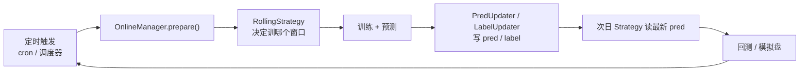

# 09 · 两条延伸线：在线服务与强化学习

> **一句话结论**：Qlib 的"在线"不是指实盘，而是指**模型与预测的滚动更新**（`qlib/workflow/online/`）；"RL"也不是通用强化学习库，而是把**回测循环变成环境**（`Simulator`）后训一个执行/择时策略。两条线共享同一个回测引擎，这是这套架构最经济的地方。

**本章源码锚点**：`qlib/workflow/online/manager.py:101`、`online/update.py:71,291`、`online/strategy.py:20,93`、`qlib/rl/simulator.py:21`、`qlib/rl/order_execution/simulator_qlib.py:19`、`qlib/rl/trainer/trainer.py:30`、`qlib/data/client.py:16`。

---

## 9.1 在线：`OnlineManager` 管的是"模型的生命周期"

`qlib/workflow/online/` 解决一个很实际的问题：**每天（或每周）收盘后，要重训/更新预测，然后把新预测写进数据库供次日使用**。它把这件事抽象成三个对象：

| 对象 | 位置 | 职责 |
|---|---|---|
| `OnlineManager` | `manager.py:101` | 持有 `OnlineStrategy` + 一组 `RecordUpdater`，`Serializable`（可存盘、可恢复） |
| `OnlineStrategy` / `RollingStrategy` | `strategy.py:20,93` | 决定"今天该训哪个模型、用哪段数据" |
| `RecordUpdater` / `PredUpdater` / `LabelUpdater` | `update.py:71,291,305` | 决定"把新预测/新标签写到哪" |

`RollingStrategy`（`strategy.py:93`）的核心是一个"时间表"：给定 `train_period`、`test_period`、`rolling_period`，它算出每个滚动窗口该产出哪个 recorder。`PredUpdater`（`:291`）则把 `pred.pkl` 落到你指定的位置（可以是数据库、可以是文件、可以是一个 `DatasetD` 的缓存）。

所以 Qlib 的"在线"链路是：



`examples/online_srv/` 的三个脚本就是这条链的可运行版本：`rolling_online_management.py`（滚动管理）、`update_online_pred.py`（更新预测）、`online_management_simulate.py`（模拟演练）。

**它不是实盘**：没有行情订阅、没有下单、没有风控。它只保证"预测是最新的、可复现的"。

## 9.2 client/server 模式：把数据放到另一台机器

`qlib.init(default_conf="client", ...)` 会走 `ClientProvider`（`data.py:1226`），它内部创建 `Client(C.flask_server, C.flask_port)`（`data.py:1252`，`qlib/data/client.py:16`）并通过 socket 请求数据。

协议很有意思：**客户端不是请求"数据"，而是请求"缓存文件的 URI"**（`data.py:1237` 的类文档）。服务端算好、落盘，客户端直接读文件——把计算留在服务端，把 IO 留在客户端。

适合的场景：数据在机房、研究在本地；或训练集群共享一份特征缓存。不适合：低延迟在线推理（多一次网络往返）。

> 服务端实现不在本仓库，协议与部署方式见 `docs/advanced/server.rst`。本仓库里只有客户端（`ClientProvider`/`Client`）与本地实现。

## 9.3 高频：同一套抽象，换频率

`examples/highfreq/` + `qlib/contrib/data/highfreq_handler.py`、`highfreq_processor.py`、`highfreq_provider.py` 展示了：分钟/秒级数据同样是"日历 + 标的 + 二进制列存"，只是 `freq="1min"`。

真正的差异在**执行层**：分钟级回测必须用 `NestedExecutor`（日频决策 + 分钟执行），且 `deal_price` 要选 `vwap` 之类，不能再用 `close`。`qlib/backtest/high_performance_ds.py` 里的 `NumpyQuote`/`PandasQuote`（`:128,103`）就是为"高频下每秒查一次报价"准备的数据结构——用 numpy 数组替代 DataFrame 查表。

> 【勘误】早期资料常把 `high_performance_ds.py` 说成"嵌套决策的位图索引"，那是旧版本。**0.9.8 里它只有 `*Quote` 与 `*Indicator` 两组类**，用途是报价查询与指标累计的加速。

## 9.4 RL：把回测循环变成环境

Qlib 的 RL 抽象只有三个接口：

```python
class Simulator(Generic[InitialStateType, StateType, ActType]):    # rl/simulator.py:21
    def step(self, action: ActType) -> None: ...                   # :57
    def get_state(self) -> StateType: ...                          # :65
    def done(self) -> bool: ...                                    # :68

class StateInterpreter(Generic[StateType, ObsType]):               # rl/interpreter.py:35
    def interpretation(self, simulator_state) -> ObsType: ...

class ActionInterpreter(Generic[StateType, PolicyActType, ActType]):  # interpreter.py:67
    def interpretation(self, simulator_state, policy_act) -> ActType: ...

class Reward(Generic[SimulatorState]):                              # rl/reward.py:16
    def reward(self, simulator_state) -> float: ...
```

关键在 `qlib/rl/order_execution/`：`SingleAssetOrderExecution`（`simulator_qlib.py:19`）把"在 `[start, end]` 时间内卖出 N 股"变成一个环境——状态是"已成交比例 + 剩余时间 + 盘口特征"，动作是"这一步卖多少"，奖励是"相对 VWAP 的价格优势"。

它跟回测引擎的关系是**复用而非重写**：`collect_data_loop` 本来就是生成器（`backtest.py:52`），`Executor` 又有 `track_data` 开关（`executor.py:90`），两者一配合就能"边回测边产出训练数据"。

训练侧在 `qlib/rl/trainer/`：`Trainer`（`trainer.py:30`）+ `Vessel`（把 fastai 的 `Learner` 包一层）+ callbacks。**依赖较重**（torch、tianshou/fastai 生态），这也是 RL 部分在 Qlib 里相对独立的原因。

## 9.5 两条线的取舍

| | 在线（`workflow/online`） | RL（`qlib/rl`） |
|---|---|---|
| 成熟度 | 中，API 稳定但文档少 | 中低，研究性质强 |
| 依赖 | MLflow + 你的调度器 | torch / fastai / tianshou |
| 建议 | 值得用，能省掉"滚动更新的脚手架" | 除非做执行算法研究，否则先跳过 |
| 与主线的耦合 | 弱（只依赖 recorder） | 中（依赖 executor 的 `collect_data`） |

## 9.6 迁移到自己系统

1. **先做"离线滚动"，再做"在线"**：用 `Trainer`/脚本按周重训、把 `pred.pkl` 写到固定路径，策略每天读。这已经覆盖 90% 的需求，不必上 `OnlineManager`。
2. **要上 `OnlineManager` 时**，先把它当"任务编排器"用：`RollingStrategy` 决定训什么，`PredUpdater` 决定写到哪，你自己的调度器负责"什么时候调 `prepare()`"。
3. **RL 不要作为第一版**：先把 `TopkDropout + NestedExecutor` 跑通，确认执行成本对收益的影响有多大，再决定要不要用 RL 优化执行。
4. **client/server 只在数据与计算分离时用**：单机研究直接用本地 `provider_uri`，少一层网络。

## 9.7 自检

1. `OnlineManager` 与 `Recorder` 是什么关系？它持久化的是什么？
2. client 模式为什么"传 URI 而不是传数据"？代价是什么？
3. `SingleAssetOrderExecution` 的状态/动作/奖励分别是什么？
4. 为什么说"RL 复用了回测引擎"，具体复用了哪两个机制？
5. 什么时候应该放弃 online 模块，自己写 cron？

> 参考答案要点：1) 它持有多个 recorder 的引用，持久化的是"任务表 + 更新器配置"；2) 把计算留在服务端、IO 留在客户端，代价是多一次往返与缓存一致性风险；3) 状态=剩余量/时间/盘口，动作=本步成交量，奖励=相对基准价的价格优势；4) `collect_data_loop` 生成器 + `Executor.track_data`；5) 当你的调度、依赖、失败重试已经很复杂、或需要跨系统编排时。
