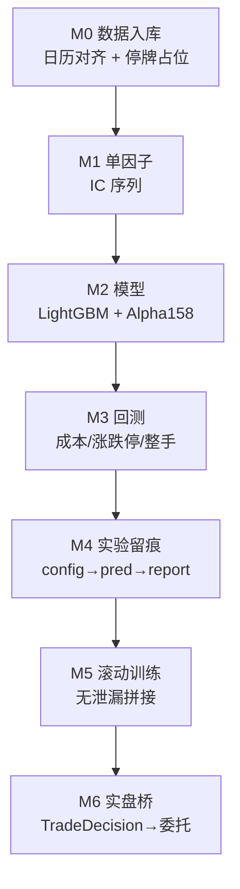

# 10 · 落地篇：把 Qlib 拆成你自己的系统

> **一句话结论**：Qlib 的每个层都有一个"官方扩展点"。正确的做法不是 fork 它，而是**在每个扩展点上写一个薄子类**，然后用自己的编排层把它们串起来。本章给出一张"扩展点 → 契约 → 陷阱"的表，以及一个分六步的最小系统路线图。

**本章源码锚点**：`qlib/data/dataset/loader.py:230`、`handler.py:633`、`processor.py:35`、`ops.py:1619`、`model/base.py:22`、`strategy/base.py:23`、`executor.py:22`、`record_temp.py:29`、`scripts/dump_bin.py`。

---

## 10.1 扩展点总表

| # | 扩展点 | 基类 / 入口 | 必须实现 | 最容易踩的坑 |
|---|---|---|---|---|
| 1 | 数据入库 | `scripts/dump_bin.py` | 目录结构 + float32 列 | 停牌不占位、复权不一致 |
| 2 | 数据访问 | `FeatureProvider`（`data.py:306`） | `feature()` | 返回的 Series 必须按日历索引 |
| 3 | 取数 | `DataLoader`（`loader.py:18`）或 `StaticDataLoader`（`:230`） | `load()` | 列名、MultiIndex 层级顺序 |
| 4 | 加工 | `Processor`（`processor.py:35`） | `__call__`（`fit` 可选） | `readonly` 语义、fit 区间泄漏 |
| 5 | 算子 | `ExpressionOps` + `OpsWrapper.register`（`ops.py:1628`） | `_load_internal`、`get_extended_window_size`、`__str__` | `__str__` 不唯一导致缓存串味 |
| 6 | 模型 | `Model`（`model/base.py:22`） | `fit`、`predict` | 索引层级、`DK_L`/`DK_I` 混用 |
| 7 | 策略 | `BaseStrategy`（`strategy/base.py:23`） | `generate_trade_decision` | 忘了 `shift`、返回空决策 |
| 8 | 执行 | `BaseExecutor`（`executor.py:22`） | `_collect_data` | 忘了 `trade_account.update_bar_end` |
| 9 | 撮合 | `Exchange`（`exchange.py:28`） | `_calc_trade_info_by_order` | 改了 `order` 却没回填 `deal_amount` |
| 10 | 实验产物 | `RecordTemp`（`record_temp.py:29`） | `_generate` + `depend_cls` | 依赖缺失被静默跳过 |

## 10.2 数据入库：先对齐格式，再谈别的

Qlib 的数据格式只有三条契约：

1. `calendars/{freq}.txt`：每行一个时间戳，升序；
2. `instruments/{market}.txt`：每行 `代码 \t 起始日 \t 结束日`；
3. `features/{instrument}/{field}.{freq}.bin`：**float32 裸数组，长度等于日历**。

第三条是全部麻烦的来源：**每个标的的每个字段，必须和日历严格等长**，停牌日填 `NaN`。一旦错位，`Ref/Mean` 全部平移，而 Qlib 不会报错。

自检脚本（仓库里就有）：`scripts/check_data_health.py`、`scripts/check_dump_bin.py`。**接新数据后第一件事就是跑这两个**。

## 10.3 自定义 Loader：`StaticDataLoader` 是最短路径

如果你已经有一张特征宽表（parquet/数据库导出），**不要写 Provider**：

```python
import pandas as pd
from qlib.data.dataset.loader import StaticDataLoader

df = pd.read_parquet("features.parquet")   # index = (instrument, datetime)
loader = StaticDataLoader(df)

from qlib.data.dataset.handler import DataHandlerLP
handler = DataHandlerLP(data_loader=loader, instruments="csi300",
                        start_time="2015-01-01", end_time="2020-12-31")
```

代价：没有表达式能力、没有磁盘缓存、`instruments` 过滤要靠 `StaticDataLoader` 的 `join` 参数。但对"离线特征已经算好"的场景，这是最省事的方案。

## 10.4 自定义 Provider：实现一个方法就够

```python
# 【示意代码】
from qlib.data.data import FeatureProvider
import pandas as pd

class MyFeatureProvider(FeatureProvider):
    def feature(self, instrument, field, start_index, end_index, freq):
        # start_index/end_index 是“日历下标”，不是日期
        return self._series[instrument][field].iloc[start_index:end_index + 1]

# 注册
qlib.init(provider_uri="~/.qlib/qlib_data/cn_data", region="cn",
          feature_provider={"class": "MyFeatureProvider", "module_path": "my_pkg.data"})
```

注意签名里的 `start_index/end_index` 是**下标**（可以是负数，表示"截止到最新"），返回的 `Series` 的 index 也要是日历下标（`RangeIndex` 或日历 `DatetimeIndex`，与 `Cal` 对齐）。写错这里，所有窗口算子都会错。

## 10.5 自定义 Processor

```python
# 【示意代码】
from qlib.data.dataset.processor import Processor
import pandas as pd

class Winsorize(Processor):
    def __init__(self, fields_group="feature", limit=0.01):
        self.fields_group = fields_group
        self.limit = limit
        self.bounds = None

    def fit(self, df: pd.DataFrame = None):
        x = df[self.fields_group]
        self.bounds = (x.quantile(self.limit), x.quantile(1 - self.limit))

    def __call__(self, df: pd.DataFrame):
        df = df.copy()
        lo, hi = self.bounds
        df[self.fields_group] = df[self.fields_group].clip(lo, hi, axis=1)
        return df

    def readonly(self):
        return False        # 我们 copy 了，返回 False 表示“不保证不改输入”
```

三条规矩：

- `fit` 只读、不写；
- `__call__` 要么 `copy` 要么保证幂等（`readonly()` 返回 `True` 时框架可能复用同一个 df）；
- 只作用于训练数据的处理器，`is_for_infer()` 返回 `False`。

## 10.6 自定义算子

```python
# 【示意代码】
import numpy as np
from qlib.data.ops import ElemOperator

class Sqrt(ElemOperator):
    def _load_internal(self, instrument, start_index, end_index, freq):
        s = self.feature.load(instrument, start_index, end_index, freq)
        return np.sqrt(s)

    def get_extended_window_size(self):
        return self.feature.get_extended_window_size()

    def __str__(self):
        return f"Sqrt({self.feature})"        # ← 必须包含所有影响结果的参数
```

注册方式二选一：`Operators.register([Sqrt])`，或 `qlib.init(..., custom_ops=[Sqrt])`（推荐，配置化）。

## 10.7 自定义 Strategy

一个"目标权重"策略的最小实现：

```python
# 【示意代码】
import pandas as pd
from qlib.strategy.base import BaseStrategy
from qlib.backtest.decision import TradeDecisionWO, Order

class MyWeightStrategy(BaseStrategy):
    def __init__(self, signal, topk=30, **kwargs):
        super().__init__(**kwargs)
        self.signal = signal
        self.topk = topk

    def generate_trade_decision(self, execute_result=None):
        step = self.trade_calendar.get_trade_step()
        t_start, t_end = self.trade_calendar.get_step_time(step)
        p_start, p_end = self.trade_calendar.get_step_time(step, shift=1)   # ← 防未来
        score = self.signal.get_signal(p_start, p_end).nlargest(self.topk)

        pos = self.trade_position
        total = pos.calculate_value()
        orders = []
        for code, _ in score.items():
            price = self.trade_exchange.get_close(code, t_end, t_end)
            target = total * (1.0 / self.topk) / price
            diff = target - pos.get_stock_amount(code)
            if abs(diff) * price < 1e4:          # 太小的调仓忽略
                continue
            orders.append(Order(stock_id=code, amount=abs(diff),
                                direction=Order.BUY if diff > 0 else Order.SELL,
                                start_time=t_start, end_time=t_end))   # ← 必须给时间窗
        return TradeDecisionWO(orders, self)
```

要点：**策略只产出"意图"**，整手取整、资金上限、涨跌停过滤全部交给 `Exchange`。

## 10.8 自定义 Executor：接实盘的正确姿势

`Executor` 的契约是"消费 `TradeDecision`，返回 `execute_result`（`[(order, trade_val, cost, price)]`），并更新 account"。接实盘时：

```python
# 【示意代码】骨架，不是可直接运行的实现
class BrokerExecutor(BaseExecutor):
    def _collect_data(self, trade_decision, level=0):
        orders = list(trade_decision.get_decision())
        results = []
        for o in orders:
            fill = self.broker.submit(o)          # 你自己的券商适配层
            o.deal_amount = fill.amount           # ← 必须回填，否则账户不会变
            results.append((o, fill.amount * fill.price, fill.fee, fill.price))
        return results, {"trade_info": results}
```

三条铁律：

1. **先查后发**：`self.trade_exchange.check_order(o)`，别把废单发出去；
2. **回填 `deal_amount`**：`Account.update_order` 依赖它；
3. **`update_bar_end` 不能省**：净值曲线、指标累计都在这里。

## 10.9 最小系统路线图（六步，每步有验收标准）



| 阶段 | 目标 | 验收标准 | 预计工作量 |
|---|---|---|---|
| M0 数据 | 一份能 `D.features` 读到的日频数据 | `D.calendar()`、`D.features(["SH600000"], ["$close"])` 正常；`check_data_health.py` 通过 | 1–3 天 |
| M1 单因子 | 一个表达式因子的 IC 序列 | `SignalRecord` 在 test 段的 Rank IC 稳定为正 | 半天 |
| M2 模型 | LightGBM + Alpha158 基线 | 复现 benchmark 的 IC/ICIR 量级 | 1 天 |
| M3 回测 | TopK + 成本 + 涨跌停约束 | 净值曲线与官方 benchmark 同量级，换手率合理 | 1 天 |
| M4 实验 | 每次运行可追溯 | `mlruns` 里能找到 config/pred/report；改一个参数能 diff | 半天 |
| M5 滚动 | 按周/月重训 + 拼接预测 | 全区间回测无需手工干预；无未来数据泄漏 | 3–5 天 |
| M6 实盘桥 | `TradeDecision` → 券商指令 | 模拟盘跑通一周，成交回填与账户一致 | 1–2 周 |

**不要跳步**：M0 错了，后面全错；M3 没做对，M5 的滚动只会放大错误。

## 10.10 反模式清单

| 反模式 | 后果 | 替代 |
|---|---|---|
| fork Qlib 改 `backtest/` | 无法跟进上游，bug 修不完 | 子类化 `Exchange`/`Executor` |
| 在 `fit` 里读测试集数据 | 泄漏，回测虚高 | 只通过 `Dataset.prepare` 取数 |
| 用 `DK_I` 训练、`DK_L` 推理 | 线上线下不一致 | 训练 `DK_L`、推理 `DK_I` |
| 在表达式里写 `Ref($close,-1)` | 静默失败/不支持 | 标签在 dataset 层构造 |
| 一个进程多套 `qlib.init` | 全局状态互相污染 | 分进程 |
| 把大 DataFrame 存进 recorder | artifact 爆炸 | `dump_all=False`，只存配置 |
| 用 `close` 作为 `deal_price` 做日频 | 偷看收盘 | `open` 或 `vwap`，或接受并在报告中说明 |

## 10.11 自检

1. 什么情况下该用 `StaticDataLoader`，而不是实现 `FeatureProvider`？
2. Processor 的 `readonly()` 返回 `True` 意味着什么？返回错了会怎样？
3. 自定义 Strategy 时，为什么不该在策略里做整手取整与资金检查？
4. 接实盘的 Executor，为什么必须回填 `order.deal_amount`？
5. M0 阶段最容易忽略、却会让后面全部返工的一件事是什么？

> 参考答案要点：1) 特征已经算好、不需要表达式与缓存；2) 保证不修改输入 df，框架可能复用同一对象；3) 那是 `Exchange` 的职责，策略只表达意图；4) `Account.update_order` 用它计算持仓与现金变化；5) 日历与停牌占位是否严格对齐。
