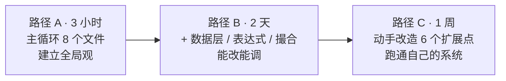

# 11 · 导读：三条阅读路径、调试技巧与踩坑索引

> **一句话结论**：Qlib 的源码可以按"**先主循环、再数据、后细节**"的顺序读，三天能建立完整心智模型。本章给你三条按时间预算切的路径、一套调试手法，以及一张"症状 → 原因 → 文件"的排错表。

---



## 11.1 路径 A：3 小时建立全局观

按顺序读，每段读完合上代码用自己的话复述一遍。

| 顺序 | 文件 | 读哪段 | 要回答的问题 |
|---|---|---|---|
| 1 | `qlib/cli/run.py` | 全文 157 行 | 一条 yaml 变成什么？ |
| 2 | `qlib/model/trainer.py` | `:50-139` | `_exe_task` 的 10 行在干什么？ |
| 3 | `qlib/backtest/__init__.py` | `:177-276` | 回测前装配了哪四个对象？ |
| 4 | `qlib/backtest/backtest.py` | 全文 109 行 | 主循环为什么是生成器？ |
| 5 | `qlib/backtest/executor.py` | `:513-628` | 一笔订单怎么被"执行"？ |
| 6 | `qlib/strategy/base.py` | `:23-146` | 策略只需要实现什么？ |
| 7 | `qlib/data/dataset/__init__.py` | `:15-250` | `prepare` 的四个参数各管什么？ |
| 8 | `qlib/workflow/record_temp.py` | `:29-260` | 一次实验的产物是谁生成的？ |

读完应该能在白板上画出 01 章那张六层图，并说出每层的一个类名。

## 11.2 路径 B：2 天精读（含数据层与表达式）

在路径 A 之上追加：

| 顺序 | 文件 | 读哪段 | 要回答的问题 |
|---|---|---|---|
| 9 | `qlib/data/data.py` | `:1142-1334` | `D` 是怎么被注册成真实对象的？ |
| 10 | `qlib/data/cache.py` | `:136-210, 489-560` | 两层缓存的 key 与失效条件 |
| 11 | `qlib/data/base.py` | 全文 281 行 | `Expression` 的三个抽象方法为什么是这三个？ |
| 12 | `qlib/data/ops.py` | `:713-900`, `:1619-1686` | 窗口算子的"扩展窗口"怎么算出来的？ |
| 13 | `qlib/data/expression_parser.py` | `:78-107, 307-322` | 白名单校验挡住了什么？ |
| 14 | `qlib/data/dataset/handler.py` | `:382-420, 633-665` | `DK_R/I/L` 与 processor 三条链的关系 |
| 15 | `qlib/data/dataset/processor.py` | `:35-130, 300-380` | `fit/__call__/readonly` 的契约 |
| 16 | `qlib/backtest/exchange.py` | `:338-470, 786-900` | 停牌、涨跌停、整手、成交量、费用在哪一行生效 |
| 17 | `qlib/backtest/account.py` | `:111-410` | 净值曲线是怎么累计出来的 |
| 18 | `qlib/workflow/expm.py` | `:22-140, 317-430` | `ExpManager` 与 MLflow 的边界 |

## 11.3 路径 C：1 周动手（每项 2–4 小时）

| 天 | 任务 | 产物 | 成功判据 |
|---|---|---|---|
| 1 | 装数据 + `qrun` 跑通 `workflow_config_lightgbm_Alpha158.yaml` | `mlruns/` 下完整 artifacts | 看到 `pred.pkl` 与 `port_analysis_day.pkl` |
| 2 | 只用代码（不用 yaml）复刻一次 | 一个 50 行脚本 | 结果与 `qrun` 指标一致 |
| 3 | 改 `dataset.segments` 与 `fit_start_time`，观察 IC 变化 | 一张对比表 | 能解释为什么变好/变差 |
| 4 | 写一个自定义 `Processor`（去极值 + 中性化）并接入 | 一个子类 | 回测指标变化可解释 |
| 5 | 写一个自定义 `Strategy`（等权 / 风险平价） | 一个子类 | 换手率、成本合理 |
| 6 | 打开 `NestedExecutor`（日 + 30min 执行） | 一份 executor 配置 | 能看到 `pa`/`ffr` 指标 |
| 7 | 做一次"滚动训练 + 拼接预测"的全区间回测 | 一段脚本 | 无未来泄漏，曲线连续 |

## 11.4 调试手法

**① 先验证数据，再怀疑模型**

```python
from qlib.data import D
D.calendar(start_time="2020-01-01", end_time="2020-01-05")
D.features(["SH600000"], ["$close", "Ref($close,1)"], start_time="2020-01-01", end_time="2020-01-10")
```

`Ref` 的第一行必须是 NaN——如果不是，说明数据或日历错位。

**② 打印而不是猜**

- `exchange.check_order(order)` 返回 `False` 时，分别调 `check_stock_suspended` 与 `check_stock_limit` 看是哪个；
- `Backtest` 卡住时，看 `trade_executor.get_all_executors()` 的层级；
- `Dataset.prepare` 返回空 DataFrame 时，先看 `segments` 是否落在 `handler` 的时间范围内。

**③ 用 `InfPosition` 隔离问题**

收益不对时，先用 `pos_type="InfPosition"` 跑一遍：如果结果变好，问题在资金/整手约束；如果不变，问题在信号。

**④ 用 recorder 反查配置**

```python
rec = R.get_recorder(experiment_name="workflow")
rec.list_params(); rec.list_artifacts()
```

**⑤ 关掉缓存复现**

```python
qlib.init(provider_uri=..., region="cn", clear_mem_cache=True)
D.features(..., disk_cache=2)     # 强制重算
```

**⑥ 小样本跑通再放大**

把 `instruments` 改成 5 只股票、`segments.test` 改成 1 个月，迭代速度会快 100 倍。

## 11.5 排错索引：症状 → 原因 → 位置

| 症状 | 最可能的原因 | 去哪看 |
|---|---|---|
| IC 高得离谱（>0.2） | 标签泄漏 / `shift` 用错 / `deal_price=close` | `contrib/strategy/signal_strategy.py:141`、`exchange.py:44` |
| 回测收益为 0 | 订单全被拒（涨跌停/停牌/trade_unit） | `exchange.py:417` 断点 |
| 持仓与订单对不上 | 自定义 Executor 没回填 `deal_amount` | `account.py:203` |
| 训练报 `KeyError: 'label'` | `col_set` 与 handler 列名不匹配 | `handler.py:328 get_cols` |
| 推理结果与训练不一致 | `DK_L`/`DK_I` 混用 | `handler.py:422` |
| `pred.pkl` 存在但分析为空 | `depend_cls` 上游缺失被跳过 | `record_temp.py:237` |
| 换了数据结果不变 | 内存/磁盘缓存未失效 | `cache.py:489`、`qlib/__init__.py:55` |
| 进程内两套数据互相污染 | `C` 是全局单例 | `config.py:335` |
| 加载 artifact 报安全错误 | `trusted=False` | `recorder.py:96` |
| 多机训练任务不动 | MongoDB 未启动 / 状态卡在 `PART_DONE` | `trainer.py:447`、`workflow/task/manage.py` |

## 11.6 符号速查

| 缩写 | 全称 | 含义 |
|---|---|---|
| `C` | Config | 全局配置单例（`qlib/config.py:335`） |
| `R` | QlibRecorder | 实验门面（`workflow/__init__.py:27`） |
| `D` | Data | 全功能数据门面（`data/data.py:1291`） |
| `DK_R/I/L` | DataKey Raw/Infer/Learn | 三种加工口径 |
| `PTYPE_A/I` | Process Type Append/Independent | 两条 processor 链的组合方式 |
| `WO` | With Order | `TradeDecisionWO`：带订单列表的决策 |
| `FT` | FineTune | `ModelFT`：可增量微调的模型 |
| `PIT` | Point-In-Time | 按"当时可见"取值的数据 |
| `pa` / `ffr` / `pos` | price advantage / fulfill rate / positive rate | 执行质量指标 |
| `TM` | TaskManager | 基于 MongoDB 的任务池 |

## 11.7 术语表

| 中文 | 英文 | 在这套系统里的具体含义 |
|---|---|---|
| 交易日历 | calendar | 一组升序时间戳，所有数组的公共下标 |
| 标的池 | instrument / market | `instruments/csi300.txt` 这类文件 |
| 特征 | feature | 表达式算出来的一列 |
| 标签 | label | 预测目标，通常是未来收益 |
| 分段 | segment | train/valid/test 的时间区间 |
| 加工 | processor | 对 DataFrame 的变换（归一化/去极值/丢样本） |
| 信号 | signal | 模型输出，按 (datetime, instrument) 索引 |
| 决策 | decision | 策略在一个交易步产出的意图集合 |
| 订单 | order | 决策的最小单元（标的、数量、方向、时间窗） |
| 执行器 | executor | 把决策变成成交的组件 |
| 撮合 | matching / deal | 判断能否成交、以什么价成交多少 |
| 换手率 | turnover | 成交额 / 组合市值 |
| 价格优势 | price advantage | 成交价相对基准价的优势 |
| 成交率 | fulfill rate | 实际成交 / 目标成交 |
| 滚动训练 | rolling | 按时间窗反复重训 |
| 实验 | experiment | 一组相关运行的主题 |
| 运行 | run / recorder | 一次具体的训练+回测 |

## 11.8 文档索引

| 想了解 | 看 |
|---|---|
| 整体架构与设计哲学 | `01-overview.md` |
| 一条 yaml 怎么跑完 | `02-layering.md` |
| 数据怎么存、怎么读、缓存怎么失效 | `03-data-layer.md` |
| `$close` 怎么变成数组 | `04-expression.md` |
| Loader/Handler/Dataset 的分工 | `05-dataset.md` |
| 模型接口与训练编排 | `06-model.md` |
| 决策、撮合、账户、报表 | `07-strategy-backtest.md` |
| 实验管理与复现 | `08-workflow.md` |
| 在线更新与 RL | `09-rl-online.md` |
| 怎么接自己的数据/模型/策略 | `10-extend.md` |
